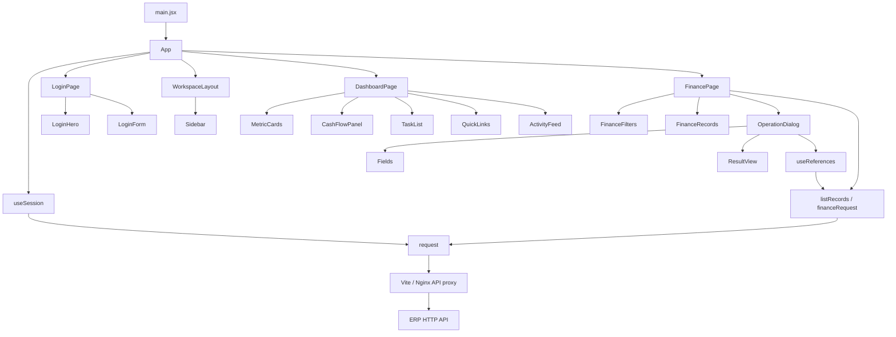
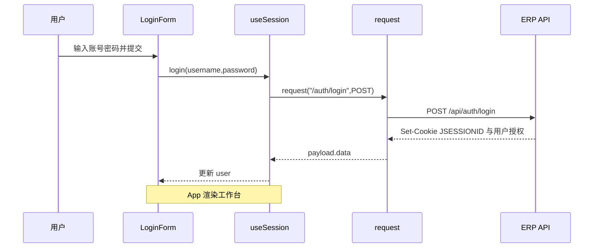

# 衡账前端项目架构与逐页接口说明

本文基于当前源码生成，覆盖登录页、财务总览和 35 个业务页。更新日期为 2026-11-09。逐页操作以 operations.js 的真实定义为准，页面描述中的规划功能与已实现接口存在差别时，以本文操作表和后端校验为准。

## 技术栈与运行边界

| 项目 | 实现 |
| --- | --- |
| 框架 | React 19，函数组件与 Hooks |
| 构建 | Vite 8 与 @vitejs/plugin-react |
| 语言 | JavaScript / JSX，ES Modules |
| 路由 | 自有 Hash 路由，监听 hashchange |
| 请求 | 浏览器 fetch，由 shared/api/client.js 统一封装 |
| 会话 | 服务端 JSESSIONID Cookie，credentials 为 same-origin |
| 状态 | 页面局部 useState，认证状态由 useSession 返回给 App |
| 样式 | 通用基础样式、共享组件样式、页面样式分别维护 |
| 部署 | 本地构建 dist，上传 Linux，Nginx 提供静态文件与 API 代理 |
| 项目边界 | 独立前端项目。运行时访问 HTTP API，前端构建无需 Java、MariaDB 或服务端源码 |

## 源码目录与职责

```text
src/
  main.jsx                         React 挂载及全局样式
  app/
    App.jsx                        会话恢复、页面访问控制、页面装配
    routing/routes.js              从业务模块配置生成路由表
    routing/useHashRoute.js        读取 Hash、监听变化、触发导航回调
    layouts/WorkspaceLayout.jsx    侧栏、顶栏、内容插槽
    layouts/Sidebar.jsx            按资源权限过滤菜单
  pages/
    login/LoginPage.jsx            登录页面布局
    login/views/                   LoginHero、LoginForm
    dashboard/DashboardPage.jsx    工作台请求与视图装配
    dashboard/views/               指标卡、趋势图、待办、快捷入口、动态
    finance/FinancePage.jsx        35 个业务页共用的页面容器
    finance/views/                 筛选、记录、操作弹窗和动态字段编辑
  features/
    auth/useSession.js             查询会话、登录、退出、失效监听
    auth/permissions.js            canAccess
    finance/model/modules/         八个模块的页面与导航描述
    finance/model/definePage.js    page 配置构造函数
    finance/api/resources.js       列表请求、筛选映射、响应字段映射
    finance/api/operations.js      每个操作的路径、方法、表单和标志
    finance/api/fields.js          中文字段名、枚举、多行明细结构
    finance/api/useReferences.js   从业务接口加载关联下拉选项
  shared/
    api/client.js                  请求、统一响应、错误、下载
    api/dates.js                   JDBC DATE 时间戳转业务日期
    ui/                            Icon、Brand 等共享组件与弹窗样式
    styles/                        基础样式与通用视觉样式
scripts/
  generate-architecture.mjs         从页面及接口定义生成本文
  seed-samples.mjs                  通过 API 创建样例数据
  deploy.ps1                       本地编译、打包、SSH/SCP 发布入口
deploy/
  nginx.conf.template              生产静态站点及 API 同源代理
  activate.sh                      服务器端激活、健康检查、失败回滚
docs/
  architecture-intro.md            本文通用架构说明源文件
  architecture-ending.md           本文运行和维护说明源文件
```

35 个业务页复用 FinancePage，由 module 和 page 配置决定页面内容；它们分别在各自的模块配置中定义，并没有 35 个重复的 JSX 页面文件。增加专用交互时，可在对应 pages 目录新增 View，再由页面容器装配。

## 组件和依赖关系



## 应用入口、路由与权限

[main.jsx](src/main.jsx) 导入基础与通用样式，通过 createRoot 挂载 App，开发期启用 StrictMode。

[App.jsx](src/app/App.jsx) 使用 useSession 获取 user、loading、error、login、logout。恢复会话期间显示加载状态，未登录时返回 LoginPage，登录后装配 WorkspaceLayout。业务路由进入 FinancePage，根路由进入 DashboardPage。

[routes.js](src/app/routing/routes.js) 遍历 modules，使用 routeFor(module,page) 生成 module.id/page.id，再由 Map 保存页面配置。getRoute(route) 返回 module 与 page。目前未知 Hash 会回退到财务总览。

[useHashRoute](src/app/routing/useHashRoute.js) 从 window.location.hash 去除 #/ 前缀，监听 hashchange 后更新 route、执行导航回调并滚动到顶部。WorkspaceLayout 的 main 使用 route 作为 key，切换页面时重建页面状态。

[canAccess](src/features/auth/permissions.js) 允许 is_admin 管理员访问全部资源。普通用户按 permissions[].resource 检查读取权限，写入还需 can_write=true 或 1。Sidebar 过滤无权访问的菜单，App 拦截直接打开的无权路由，FinancePage 过滤写操作入口。接口权限继续由后端执行。

## 登录页面

### 组件与状态

| 文件或组件 | 职责 |
| --- | --- |
| [LoginPage](src/pages/login/LoginPage.jsx) | 组合 LoginHero、LoginForm 和页脚，将 onLogin 传给表单 |
| [LoginHero](src/pages/login/views/LoginHero.jsx) | 品牌区、产品文案和业务流程装饰，使用共享 Brand、Icon |
| [LoginForm](src/pages/login/views/LoginForm.jsx) | 账号密码输入、显示密码切换、提交状态、错误显示 |
| [useSession](src/features/auth/useSession.js) | 执行登录请求并把返回的用户资料写入 user 状态 |
| [request](src/shared/api/client.js) | 拼接 /api、发送 Cookie、解析统一响应与错误 |

LoginForm 保存 username、password、showPassword、error 和 busy。submit(event) 先阻止默认表单提交，设置 busy，调用 await onLogin(username,password)。请求失败显示 failure.message，请求结束恢复按钮。密码显示切换只改变 input 的 type。

### 登录、恢复会话和退出的实际调用

| 行为 | 调用链 | HTTP 接口 | 请求或结果 |
| --- | --- | --- | --- |
| 登录 | LoginForm.submit → App 传入的 login → useSession.login → request | POST /api/auth/login | JSON 包含 username.trim() 与原始 password；读取 data 中的用户、角色与授权 |
| 刷新恢复 | App → useSession.useEffect → request | GET /api/auth/session | 读取当前 JSESSIONID 对应的用户，401 时维持未登录 |
| 退出 | WorkspaceLayout 退出按钮 → App.handleLogout → useSession.logout → request | POST /api/auth/logout | JSON 空对象；成功后清空 user，Hash 改为 #/ |
| 会话失效 | request 收到非登录接口的 401 → session-expired 事件 → useSession 监听器 | 任何受保护接口 | 清空 user，使 App 重新显示 LoginPage |



前端没有本地密码比对，不把登录成功标记写入 sessionStorage 或 localStorage。登录后的有效性以服务端会话为准。登录成功保留原来想访问的 Hash，退出成功回到根 Hash。

## 财务总览页面

路由为 #/，权限资源为 dashboard。页面容器是 [DashboardPage](src/pages/dashboard/DashboardPage.jsx)。

| View | 传入数据 | 展示或动作 |
| --- | --- | --- |
| MetricCards | data、currency | balances 汇总资金余额、monthly 汇总收付款、tasks 汇总待办，点击卡片进入相应业务 Hash |
| CashFlowPanel | data.trend、period | 生成连续六个月的柱状图，以万元显示实际收付款，缺失月份按 0 展示 |
| TaskList | data.tasks | 按 resource 展示当前角色待办数量，点击进入业务页 |
| QuickLinks | dashboardData.shortcuts | 展示预设导航链接，不单独请求接口 |
| ActivityFeed | data.activities | 展示操作类型、资源、业务对象和操作时间，链接到相应业务页 |

DashboardPage 保存 period、currency、data 和 error。period 初始为浏览器当前月份，currency 初始为 CNY。useEffect 在 period 或 currency 变化时调用 listRecords('dashboard',{period_code:period,currency},signal)，最终发送 GET /api/finance/dashboard?period_code=...&currency=...。请求返回 period、balances、monthly、trend、tasks、activities。切换条件或卸载时通过 AbortController 取消上一次请求。

## 通用业务页面的请求与渲染流程

### FinancePage 的状态与方法

| 名称 | 职责 |
| --- | --- |
| resource | 由 module.id 和 page.id 组成，例如 gl/vouchers |
| filters | 用户正在编辑的查询条件，以中文条件名为 key |
| query | 已提交给服务器的 snake_case 条件与 page、size |
| data | items、total，以及常规分页或报表元数据 |
| selected | 勾选的后台记录 id，用于批量审核或记账 |
| operation | 当前打开的操作、记录 id、初始值、目标资源 |
| revision | 写操作成功后增加，触发重新查询 |
| search() | filterParams 转换条件，设置 loading，并从第 1 页查询 |
| refresh() | 增加 revision，重新执行列表请求 |
| runAction([title],id) | 查询 operations 定义，处理导出、选中校验、编辑回填、打开弹窗 |
| submit(body) | 替换路径参数、组装 JSON 或 FormData、执行操作、成功刷新 |

### View 组件

| 组件 | 输入 | 内部逻辑 |
| --- | --- | --- |
| FinanceFilters | page、filters、onChange、onReset、onQuery | 内部 FilterField 按名称选择文本、月份、日期或枚举控件；提交时调用 onQuery |
| FinanceRecords | page、actions、rowActions、rowIds、selected、回调 | 按后台 id 渲染勾选、表格和行操作；内部 RowActions 选择动作并回调 onAction |
| OperationDialog | title、operation、initial、onSubmit、onClose | 原生 dialog 管理焦点，保存 values、busy、error、result；成功显示 ResultView |
| Fields | specs、values、references、onChange | 根据字段定义生成输入、多行明细和关联选择器 |
| ResultView | data | 递归展示对象、数组与基础值，通过 fieldLabels 转换已定义的中文名称 |

### 字段与操作定义

operations.js 中 create、row、get、post 是操作定义构造函数，不直接发送请求。resource 用于覆写当前页面资源，suffix 定义路径后缀。row=true 把动作放入行操作，batch=true 要求勾选记录，download=true 直接导出，downloadFile=true 进入附件 Blob 下载，refresh=true 重新查询，unsupported 只显示支持范围。

字段以空格分隔。字段后缀 ? 表示选填，冒号之后表示特殊结构，例如 lines:voucher、steps:workflow、permissions:permissions、segments:numbers。numbers 把逗号分隔内容转成数字数组，多行明细按 lineSchemas 白名单提交字段。can_write 未勾选时显式提交 false。

### HTTP 与数据转换

request(path,options) 为 path 添加 /api 前缀。普通 JSON 操作设置 Content-Type，FormData 交由浏览器生成 multipart boundary。成功响应取 payload.data，HTTP 错误以 ApiError(message,status) 抛出。queryString 省略空字符串、null 和 undefined。

listRecords(resource,params,signal) 拼查询参数，调用 financeRequest。financeRequest 为资源添加 /finance/ 前缀，再调用 request。displayPage 根据字段映射把后端对象转为表格行，同时保存后台 id 供行操作使用。

日期方面，当前服务端的 JDBC DATE 可能返回 UTC 午夜对应的时间戳。normalizeApiData 递归处理 date、*_date、*_on 字段，按 Asia/Shanghai 转回 yyyy-MM-dd。普通操作时间 *_at 不走这个日期转换。

常规列表为 {items,total,page,size}，报表和汇总为 {items,total,...元数据}。只有响应带 page 时，列表下一页才启用。普通列表默认每页 20 条。导出沿用当前筛选，移除分页参数。

文件下载会读取 Blob，解析 Content-Disposition 的 UTF-8 文件名，创建临时 ObjectURL 下载，并在完成后释放。失败仍读取 JSON message。附件上传前端检查 10 MB，服务器负责进一步的文件类型、数量、归属和权限检查。

## 逐页索引

下文每个业务页均列出实际 View 组件、查询字段、展示字段、操作路径和请求参数。前端执行请求的公共方法已在上文解释，每页的“操作”表给出展开后的路径。


| 序号 | 模块 | 页面 | 路由 |
| --- | --- | --- | --- |
| — | 认证 | [登录页面](#登录页面) | 未登录时显示 |
| — | 工作台 | [财务总览](#财务总览页面) | `#/` |
| 1 | 总账管理 | [会计科目](#1-会计科目) | `#/gl/accounts` |
| 2 | 总账管理 | [凭证管理](#2-凭证管理) | `#/gl/vouchers` |
| 3 | 总账管理 | [期末处理](#3-期末处理) | `#/gl/closing` |
| 4 | 总账管理 | [账簿查询](#4-账簿查询) | `#/gl/ledgers` |
| 5 | 应收管理 | [应收单](#5-应收单) | `#/ar/receivables` |
| 6 | 应收管理 | [收款核销](#6-收款核销) | `#/ar/collections` |
| 7 | 应收管理 | [账龄分析](#7-账龄分析) | `#/ar/ar-aging` |
| 8 | 应收管理 | [坏账处理](#8-坏账处理) | `#/ar/bad-debts` |
| 9 | 应付管理 | [应付单](#9-应付单) | `#/ap/payables` |
| 10 | 应付管理 | [付款核销](#10-付款核销) | `#/ap/payments` |
| 11 | 应付管理 | [应付账龄](#11-应付账龄) | `#/ap/ap-aging` |
| 12 | 应付管理 | [应付票据](#12-应付票据) | `#/ap/notes` |
| 13 | 资金管理 | [银行账户](#13-银行账户) | `#/funds/bank-accounts` |
| 14 | 资金管理 | [资金收付](#14-资金收付) | `#/funds/cash-orders` |
| 15 | 资金管理 | [银行对账](#15-银行对账) | `#/funds/reconciliation` |
| 16 | 资金管理 | [资金计划](#16-资金计划) | `#/funds/cash-plans` |
| 17 | 费用报销 | [报销申请](#17-报销申请) | `#/expense/claims` |
| 18 | 费用报销 | [借款管理](#18-借款管理) | `#/expense/loans` |
| 19 | 费用报销 | [审批流](#19-审批流) | `#/expense/approvals` |
| 20 | 费用报销 | [报销支付](#20-报销支付) | `#/expense/expense-payments` |
| 21 | 固定资产 | [资产卡片](#21-资产卡片) | `#/fa/asset-cards` |
| 22 | 固定资产 | [折旧计提](#22-折旧计提) | `#/fa/depreciation` |
| 23 | 固定资产 | [资产变动](#23-资产变动) | `#/fa/asset-movements` |
| 24 | 固定资产 | [资产处置](#24-资产处置) | `#/fa/asset-disposals` |
| 25 | 财务报表 | [资产负债表](#25-资产负债表) | `#/reports/balance-sheet` |
| 26 | 财务报表 | [利润表](#26-利润表) | `#/reports/income-statement` |
| 27 | 财务报表 | [现金流量表](#27-现金流量表) | `#/reports/cash-flow` |
| 28 | 财务报表 | [自定义报表](#28-自定义报表) | `#/reports/custom-reports` |
| 29 | 系统管理 | [用户与角色](#29-用户与角色) | `#/system/users` |
| 30 | 系统管理 | [权限管理](#30-权限管理) | `#/system/permissions` |
| 31 | 系统管理 | [审批流配置](#31-审批流配置) | `#/system/workflow` |
| 32 | 系统管理 | [基础数据](#32-基础数据) | `#/system/master-data` |
| 33 | 系统管理 | [会计期间](#33-会计期间) | `#/system/periods` |
| 34 | 系统管理 | [操作日志](#34-操作日志) | `#/system/logs` |
| 35 | 系统管理 | [备份与恢复](#35-备份与恢复) | `#/system/backups` |

## 总账管理


### 1. 会计科目

维护科目层级、余额方向和辅助核算设置。

| 项目 | 实现 |
| --- | --- |
| 浏览器路由 | `#/gl/accounts` |
| 权限资源 | `gl/accounts`，写操作另外检查 can_write |
| 页面容器 | [FinancePage](src/pages/finance/FinancePage.jsx) |
| View 组件 | FinanceFilters（内部 FilterField）、FinanceRecords（内部 RowActions）、OperationDialog（内部 Fields / ResultView） |
| 配置入口 | [src/features/finance/model/modules/generalLedger.js](src/features/finance/model/modules/generalLedger.js) |
| 接口定义 | [resources.js](src/features/finance/api/resources.js)、[operations.js](src/features/finance/api/operations.js) |
| 首次加载及查询 | FinancePage.useEffect → listRecords(resource, query, signal) → financeRequest → request |
| 查询地址 | `GET /api/finance/gl/accounts` |
| 响应读取 | data.items、data.total；常规列表另含 data.page、data.size；displayPage 按字段映射生成展示行 |

#### 查询条件

| 页面条件 | 请求字段 | 说明 |
| --- | --- | --- |
| 科目名称或编码 | `q` | 空值在 queryString 中省略 |
| 科目类别 | `category` | 空值在 queryString 中省略 |
| 状态 | `status` | 空值在 queryString 中省略 |

常规分页参数为 `page=1&size=20`。查询按钮调用 search() 并回到第 1 页，重置按钮只恢复输入条件，需要再次点击查询。

#### 列表字段

| 显示列 | 响应字段 |
| --- | --- |
| 科目编码 | `code` |
| 科目名称 | `name` |
| 科目类别 | `category` |
| 余额方向 | `balance_side` |
| 辅助核算 | `dimensions` |
| 层级 | `account_level` |
| 状态 | `status` |

#### 操作、调用方法与接口

所有下列操作由 FinancePage.runAction([title], id) 解析定义。需要输入或确认的操作打开 OperationDialog，表单 submit(event) 调用 FinancePage.submit(body)，再调用 financeRequest 与 request。

| 操作 | 入口 | 请求 | 参数与处理 |
| --- | --- | --- | --- |
| 查看详情 | 通用行操作 | `GET /api/finance/gl/accounts/{id}` | FinancePage.runAction 默认使用 GET /:id，FinancePage.submit 发出查询 |
| 新增科目 | 工具栏或主按钮 | `POST /api/finance/gl/accounts` | `code`（编码）；`name`（名称）；`category`（类别）；`balance_side`（余额方向）；`parent_id`（上级科目），选填；`dimensions`（辅助核算维度），选填 |
| 编辑科目 | 行操作，使用记录 id | `POST /api/finance/gl/accounts/{id}/edit` | `name`（名称）；`dimensions`（辅助核算维度），选填 |
| 停用科目 | 行操作，使用记录 id | `POST /api/finance/gl/accounts/{id}/disable` | 无需输入参数，写请求发送空对象 |
| 删除科目 | 行操作，使用记录 id | `POST /api/finance/gl/accounts/{id}/delete` | 无需输入参数，写请求发送空对象 |
| 配置编码规则 | 工具栏或主按钮 | `POST /api/finance/gl/accounts/code-rule` | `segments`（编码分段（逗号分隔）），结构 numbers；固定或默认值 `{"segments":[4,2,2,2,2]}` |
| 导入模板 | 工具栏或主按钮 | `POST /api/finance/gl/accounts/import` | `file`（上传文件） |
| 导出 Excel | 工具栏，直接下载 | `GET /api/finance/gl/accounts/export` | 沿用当前筛选，移除 page、size |

#### 状态与结果

filters 保存正在编辑的条件，query 保存已提交条件；selected 保存后台记录 id；operation 保存当前操作定义及回填数据。写请求成功后 refresh() 增加 revision，重新查询列表并清空勾选；失败时保留弹窗输入并显示服务端 message。是否允许业务状态迁移最终由服务端校验。

### 2. 凭证管理

录入、审核和记账，跟踪凭证从草稿到入账的状态。

| 项目 | 实现 |
| --- | --- |
| 浏览器路由 | `#/gl/vouchers` |
| 权限资源 | `gl/vouchers`，写操作另外检查 can_write |
| 页面容器 | [FinancePage](src/pages/finance/FinancePage.jsx) |
| View 组件 | FinanceFilters（内部 FilterField）、FinanceRecords（内部 RowActions）、OperationDialog（内部 Fields / ResultView） |
| 配置入口 | [src/features/finance/model/modules/generalLedger.js](src/features/finance/model/modules/generalLedger.js) |
| 接口定义 | [resources.js](src/features/finance/api/resources.js)、[operations.js](src/features/finance/api/operations.js) |
| 首次加载及查询 | FinancePage.useEffect → listRecords(resource, query, signal) → financeRequest → request |
| 查询地址 | `GET /api/finance/gl/vouchers` |
| 响应读取 | data.items、data.total；常规列表另含 data.page、data.size；displayPage 按字段映射生成展示行 |

#### 查询条件

| 页面条件 | 请求字段 | 说明 |
| --- | --- | --- |
| 会计期间 | `period_code` | 初始值为浏览器当前月份，格式 yyyy-MM |
| 凭证号或摘要 | `q` | 空值在 queryString 中省略 |
| 状态 | `status` | 空值在 queryString 中省略 |

常规分页参数为 `page=1&size=20`。查询按钮调用 search() 并回到第 1 页，重置按钮只恢复输入条件，需要再次点击查询。

#### 列表字段

| 显示列 | 响应字段 |
| --- | --- |
| 凭证字号 | `voucher_no` |
| 凭证日期 | `voucher_date` |
| 摘要 | `summary` |
| 借方金额 | `debit_total` |
| 贷方金额 | `credit_total` |
| 制单人 | `maker` |
| 状态 | `status` |

#### 操作、调用方法与接口

所有下列操作由 FinancePage.runAction([title], id) 解析定义。需要输入或确认的操作打开 OperationDialog，表单 submit(event) 调用 FinancePage.submit(body)，再调用 financeRequest 与 request。

| 操作 | 入口 | 请求 | 参数与处理 |
| --- | --- | --- | --- |
| 新增凭证 | 工具栏或主按钮 | `POST /api/finance/gl/vouchers` | `voucher_date`（凭证日期）；`summary`（摘要）；`lines`（明细），结构 voucher |
| 查看凭证 | 行操作，使用记录 id | `GET /api/finance/gl/vouchers/{id}` | 无需输入参数，写请求发送空对象 |
| 编辑凭证 | 行操作，使用记录 id | `POST /api/finance/gl/vouchers/{id}/edit` | `voucher_date`（凭证日期）；`summary`（摘要）；`lines`（明细），结构 voucher |
| 提交审核 | 行操作，使用记录 id | `POST /api/finance/gl/vouchers/{id}/submit` | 无需输入参数，写请求发送空对象 |
| 批量审核 | 工具栏，先勾选凭证 | `POST /api/finance/gl/vouchers/batch/approve` | `{ ids: selected }` |
| 批量记账 | 工具栏，先勾选凭证 | `POST /api/finance/gl/vouchers/batch/post` | `{ ids: selected }` |
| 复制凭证 | 行操作，使用记录 id | `POST /api/finance/gl/vouchers/{id}/copy` | `voucher_date`（凭证日期） |
| 红字冲销 | 行操作，使用记录 id | `POST /api/finance/gl/vouchers/{id}/reverse` | `voucher_date`（凭证日期）；`reason`（原因） |
| 作废凭证 | 行操作，使用记录 id | `POST /api/finance/gl/vouchers/{id}/void` | 无需输入参数，写请求发送空对象 |
| 断号检查 | 工具栏或主按钮 | `GET /api/finance/gl/vouchers/periods/{period_id}/gaps` | `period_id`（会计期间） |
| 凭证模板 | 支持范围提示 | 不发送请求 | 服务端尚未提供凭证模板配置接口。 |
| 上传附件 | 行操作，使用记录 id | `POST /api/finance/gl/vouchers/{id}/attachments` | `file`（上传文件） |
| 下载附件 | 行操作，使用记录 id | `GET /api/finance/gl/vouchers/{id}/attachments/{attachment_id}` | `attachment_id`（附件 ID（可从详情查看）） |
| 审核凭证 | 行操作，使用记录 id | `POST /api/finance/gl/vouchers/{id}/approve` | 无需输入参数，写请求发送空对象 |
| 记账 | 行操作，使用记录 id | `POST /api/finance/gl/vouchers/{id}/post` | 无需输入参数，写请求发送空对象 |

上传使用 multipart FormData，file 保持 File 对象，不手动设置 Content-Type。前端限制单文件 10 MB，服务器继续校验类型、归属和附件数量。下载附件时 downloadFile=true 进入 request 的 Blob 分支，附件 ID 可以从详情返回的 attachments 中读取。

#### 状态与结果

filters 保存正在编辑的条件，query 保存已提交条件；selected 保存后台记录 id；operation 保存当前操作定义及回填数据。写请求成功后 refresh() 增加 revision，重新查询列表并清空勾选；失败时保留弹窗输入并显示服务端 message。是否允许业务状态迁移最终由服务端校验。

### 3. 期末处理

完成损益结转、月末结账和年度结转。

| 项目 | 实现 |
| --- | --- |
| 浏览器路由 | `#/gl/closing` |
| 权限资源 | `gl/closing`，写操作另外检查 can_write |
| 页面容器 | [FinancePage](src/pages/finance/FinancePage.jsx) |
| View 组件 | FinanceFilters（内部 FilterField）、FinanceRecords（内部 RowActions）、OperationDialog（内部 Fields / ResultView） |
| 配置入口 | [src/features/finance/model/modules/generalLedger.js](src/features/finance/model/modules/generalLedger.js) |
| 接口定义 | [resources.js](src/features/finance/api/resources.js)、[operations.js](src/features/finance/api/operations.js) |
| 首次加载及查询 | FinancePage.useEffect → listRecords(resource, query, signal) → financeRequest → request |
| 查询地址 | `GET /api/finance/gl/closing` |
| 响应读取 | data.items、data.total；常规列表另含 data.page、data.size；displayPage 按字段映射生成展示行 |

#### 查询条件

| 页面条件 | 请求字段 | 说明 |
| --- | --- | --- |
| 会计期间 | `period_code` | 初始值为浏览器当前月份，格式 yyyy-MM |
| 状态 | `status` | 空值在 queryString 中省略 |

常规分页参数为 `page=1&size=20`。查询按钮调用 search() 并回到第 1 页，重置按钮只恢复输入条件，需要再次点击查询。

#### 列表字段

| 显示列 | 响应字段 |
| --- | --- |
| 会计期间 | `period_code` |
| 未记账凭证数 | `pending_vouchers` |
| 状态 | `status` |

#### 操作、调用方法与接口

所有下列操作由 FinancePage.runAction([title], id) 解析定义。需要输入或确认的操作打开 OperationDialog，表单 submit(event) 调用 FinancePage.submit(body)，再调用 financeRequest 与 request。

| 操作 | 入口 | 请求 | 参数与处理 |
| --- | --- | --- | --- |
| 查看详情 | 通用行操作 | `GET /api/finance/gl/closing/{id}` | FinancePage.runAction 默认使用 GET /:id，FinancePage.submit 发出查询 |
| 执行结账检查 | 行操作，使用记录 id | `GET /api/finance/gl/closing/{id}/check` | 无需输入参数，写请求发送空对象 |
| 结转损益 | 行操作，使用记录 id | `POST /api/finance/gl/closing/{id}/transfer-profit` | `profit_account_id`（本年利润科目） |
| 月末结账 | 行操作，使用记录 id | `POST /api/finance/gl/closing/{id}/close` | 无需输入参数，写请求发送空对象 |
| 反结账 | 行操作，使用记录 id | `POST /api/finance/gl/closing/{id}/reopen` | `reason`（原因） |
| 年度结转 | 行操作，使用记录 id | `POST /api/finance/gl/closing/{id}/year-carryover` | 无需输入参数，写请求发送空对象 |

#### 状态与结果

filters 保存正在编辑的条件，query 保存已提交条件；selected 保存后台记录 id；operation 保存当前操作定义及回填数据。写请求成功后 refresh() 增加 revision，重新查询列表并清空勾选；失败时保留弹窗输入并显示服务端 message。是否允许业务状态迁移最终由服务端校验。

### 4. 账簿查询

查看科目余额、分录明细和辅助核算账簿。

| 项目 | 实现 |
| --- | --- |
| 浏览器路由 | `#/gl/ledgers` |
| 权限资源 | `gl/ledgers`，写操作另外检查 can_write |
| 页面容器 | [FinancePage](src/pages/finance/FinancePage.jsx) |
| View 组件 | FinanceFilters（内部 FilterField）、FinanceRecords（内部 RowActions）、OperationDialog（内部 Fields / ResultView） |
| 配置入口 | [src/features/finance/model/modules/generalLedger.js](src/features/finance/model/modules/generalLedger.js) |
| 接口定义 | [resources.js](src/features/finance/api/resources.js)、[operations.js](src/features/finance/api/operations.js) |
| 首次加载及查询 | FinancePage.useEffect → listRecords(resource, query, signal) → financeRequest → request |
| 查询地址 | `GET /api/finance/gl/ledgers` |
| 响应读取 | data.items、data.total；常规列表另含 data.page、data.size；displayPage 按字段映射生成展示行 |

#### 查询条件

| 页面条件 | 请求字段 | 说明 |
| --- | --- | --- |
| 账簿类型 | `ledger_type` | 空值在 queryString 中省略 |
| 开始期间 | `start_period` | 初始值为浏览器当前月份，格式 yyyy-MM |
| 结束期间 | `end_period` | 初始值为浏览器当前月份，格式 yyyy-MM |
| 科目层级 | `account_level` | 空值在 queryString 中省略 |
| 辅助核算 | `department_id` | 空值在 queryString 中省略 |

常规分页参数为 `page=1&size=20`。查询按钮调用 search() 并回到第 1 页，重置按钮只恢复输入条件，需要再次点击查询。

#### 列表字段

| 显示列 | 响应字段 |
| --- | --- |
| 科目编码 | `account_code` |
| 科目名称 | `account_name` |
| 期初余额 | `opening_balance` |
| 本期借方 | `debit` |
| 本期贷方 | `credit` |
| 期末余额 | `closing_balance` |

选择明细账或多栏账时，展示列切换为凭证字号、凭证日期、科目名称、摘要、借方金额和贷方金额，对应 voucher_no、voucher_date、account_name、summary、debit、credit。

#### 操作、调用方法与接口

所有下列操作由 FinancePage.runAction([title], id) 解析定义。需要输入或确认的操作打开 OperationDialog，表单 submit(event) 调用 FinancePage.submit(body)，再调用 financeRequest 与 request。

| 操作 | 入口 | 请求 | 参数与处理 |
| --- | --- | --- | --- |
| 导出 Excel | 工具栏，直接下载 | `GET /api/finance/gl/ledgers/export` | 沿用当前筛选，移除 page、size |
| 联查凭证 | 工具栏或主按钮 | `GET /api/finance/gl/vouchers/{voucher_id}` | `voucher_id` |

#### 状态与结果

filters 保存正在编辑的条件，query 保存已提交条件；selected 保存后台记录 id；operation 保存当前操作定义及回填数据。写请求成功后 refresh() 增加 revision，重新查询列表并清空勾选；失败时保留弹窗输入并显示服务端 message。是否允许业务状态迁移最终由服务端校验。

## 应收管理


### 5. 应收单

登记客户应收款，跟踪审核、到期及核销情况。

| 项目 | 实现 |
| --- | --- |
| 浏览器路由 | `#/ar/receivables` |
| 权限资源 | `ar/receivables`，写操作另外检查 can_write |
| 页面容器 | [FinancePage](src/pages/finance/FinancePage.jsx) |
| View 组件 | FinanceFilters（内部 FilterField）、FinanceRecords（内部 RowActions）、OperationDialog（内部 Fields / ResultView） |
| 配置入口 | [src/features/finance/model/modules/receivables.js](src/features/finance/model/modules/receivables.js) |
| 接口定义 | [resources.js](src/features/finance/api/resources.js)、[operations.js](src/features/finance/api/operations.js) |
| 首次加载及查询 | FinancePage.useEffect → listRecords(resource, query, signal) → financeRequest → request |
| 查询地址 | `GET /api/finance/ar/receivables` |
| 响应读取 | data.items、data.total；常规列表另含 data.page、data.size；displayPage 按字段映射生成展示行 |

#### 查询条件

| 页面条件 | 请求字段 | 说明 |
| --- | --- | --- |
| 客户 | `party` | 空值在 queryString 中省略 |
| 到期日期 | `due_date` | 空值在 queryString 中省略 |
| 状态 | `status` | 空值在 queryString 中省略 |

常规分页参数为 `page=1&size=20`。查询按钮调用 search() 并回到第 1 页，重置按钮只恢复输入条件，需要再次点击查询。

#### 列表字段

| 显示列 | 响应字段 |
| --- | --- |
| 应收单号 | `order_no` |
| 客户 | `party` |
| 应收日期 | `order_date` |
| 到期日 | `due_date` |
| 币种 | `currency` |
| 应收金额 | `amount` |
| 未核销金额 | `open_amount` |
| 状态 | `status` |

#### 操作、调用方法与接口

所有下列操作由 FinancePage.runAction([title], id) 解析定义。需要输入或确认的操作打开 OperationDialog，表单 submit(event) 调用 FinancePage.submit(body)，再调用 financeRequest 与 request。

| 操作 | 入口 | 请求 | 参数与处理 |
| --- | --- | --- | --- |
| 查看详情 | 通用行操作 | `GET /api/finance/ar/receivables/{id}` | FinancePage.runAction 默认使用 GET /:id，FinancePage.submit 发出查询 |
| 新增应收单 | 工具栏或主按钮 | `POST /api/finance/ar/receivables` | `party_id`（往来单位）；`order_date`（单据日期）；`due_date`（到期日期）；`amount`（金额）；`trade_account_id`（往来科目）；`counterpart_account_id`（对方科目）；`currency`（币种），选填；`exchange_rate`（汇率），选填；`tax_amount`（税额），选填；`tax_account_id`（税额科目），选填；`department_id`（部门），选填；`project_id`（项目），选填 |
| 同步销售单据 | 工具栏或主按钮 | `POST /api/finance/ar/receivables/sync` | `party_id`（往来单位）；`order_date`（单据日期）；`due_date`（到期日期）；`amount`（金额）；`trade_account_id`（往来科目）；`counterpart_account_id`（对方科目）；`currency`（币种），选填；`exchange_rate`（汇率），选填；`tax_amount`（税额），选填；`tax_account_id`（税额科目），选填；`department_id`（部门），选填；`project_id`（项目），选填；`source_type`（来源类型）；`source_no`（来源编号） |
| 审核并生成凭证 | 行操作，使用记录 id | `POST /api/finance/ar/receivables/{id}/approve` | 无需输入参数，写请求发送空对象 |

#### 状态与结果

filters 保存正在编辑的条件，query 保存已提交条件；selected 保存后台记录 id；operation 保存当前操作定义及回填数据。写请求成功后 refresh() 增加 revision，重新查询列表并清空勾选；失败时保留弹窗输入并显示服务端 message。是否允许业务状态迁移最终由服务端校验。

### 6. 收款核销

登记收款，按客户匹配应收单并处理预收款。

| 项目 | 实现 |
| --- | --- |
| 浏览器路由 | `#/ar/collections` |
| 权限资源 | `ar/collections`，写操作另外检查 can_write |
| 页面容器 | [FinancePage](src/pages/finance/FinancePage.jsx) |
| View 组件 | FinanceFilters（内部 FilterField）、FinanceRecords（内部 RowActions）、OperationDialog（内部 Fields / ResultView） |
| 配置入口 | [src/features/finance/model/modules/receivables.js](src/features/finance/model/modules/receivables.js) |
| 接口定义 | [resources.js](src/features/finance/api/resources.js)、[operations.js](src/features/finance/api/operations.js) |
| 首次加载及查询 | FinancePage.useEffect → listRecords(resource, query, signal) → financeRequest → request |
| 查询地址 | `GET /api/finance/ar/collections` |
| 响应读取 | data.items、data.total；常规列表另含 data.page、data.size；displayPage 按字段映射生成展示行 |

#### 查询条件

| 页面条件 | 请求字段 | 说明 |
| --- | --- | --- |
| 客户 | `party` | 空值在 queryString 中省略 |
| 收款日期 | `transaction_date` | 空值在 queryString 中省略 |
| 状态 | `status` | 空值在 queryString 中省略 |

常规分页参数为 `page=1&size=20`。查询按钮调用 search() 并回到第 1 页，重置按钮只恢复输入条件，需要再次点击查询。

#### 列表字段

| 显示列 | 响应字段 |
| --- | --- |
| 收款单号 | `order_no` |
| 客户 | `party` |
| 收款账户 | `account_name` |
| 收款日期 | `transaction_date` |
| 收款金额 | `amount` |
| 已核销金额 | `settled_amount` |
| 状态 | `status` |

#### 操作、调用方法与接口

所有下列操作由 FinancePage.runAction([title], id) 解析定义。需要输入或确认的操作打开 OperationDialog，表单 submit(event) 调用 FinancePage.submit(body)，再调用 financeRequest 与 request。

| 操作 | 入口 | 请求 | 参数与处理 |
| --- | --- | --- | --- |
| 查看详情 | 通用行操作 | `GET /api/finance/ar/collections/{id}` | FinancePage.runAction 默认使用 GET /:id，FinancePage.submit 发出查询 |
| 登记收款 | 工具栏或主按钮 | `POST /api/finance/ar/collections` | `bank_account_id`（资金账户）；`counterpart_account_id`（对方科目）；`transaction_date`（交易日期）；`purpose`（用途或事由）；`amount`（金额）；`party_id`（往来单位）；`exchange_rate`（汇率），选填 |
| 手工核销 | 行操作，使用记录 id | `POST /api/finance/ar/collections/{id}/settle` | `trade_id`（往来单据）；`amount`（金额）；`settled_on`（核销日期）；`request_key`（核销请求编号） |
| 自动匹配 | 行操作，使用记录 id | `GET /api/finance/ar/collections/{id}/suggestions` | 无需输入参数，写请求发送空对象 |
| 反核销 | 行操作，使用记录 id | `POST /api/finance/ar/collections/{id}/reverse-settlement` | `settlement_id`（核销记录 ID）；`reversed_on`（反核销日期） |
| 确认收款 | 行操作，使用记录 id | `POST /api/finance/funds/cash-orders/{id}/approve` | 无需输入参数，写请求发送空对象 |

#### 状态与结果

filters 保存正在编辑的条件，query 保存已提交条件；selected 保存后台记录 id；operation 保存当前操作定义及回填数据。写请求成功后 refresh() 增加 revision，重新查询列表并清空勾选；失败时保留弹窗输入并显示服务端 message。是否允许业务状态迁移最终由服务端校验。

### 7. 账龄分析

按客户、科目和辅助核算查看应收款的逾期分布。

| 项目 | 实现 |
| --- | --- |
| 浏览器路由 | `#/ar/ar-aging` |
| 权限资源 | `ar/ar-aging`，写操作另外检查 can_write |
| 页面容器 | [FinancePage](src/pages/finance/FinancePage.jsx) |
| View 组件 | FinanceFilters（内部 FilterField）、FinanceRecords（内部 RowActions）、OperationDialog（内部 Fields / ResultView） |
| 配置入口 | [src/features/finance/model/modules/receivables.js](src/features/finance/model/modules/receivables.js) |
| 接口定义 | [resources.js](src/features/finance/api/resources.js)、[operations.js](src/features/finance/api/operations.js) |
| 首次加载及查询 | FinancePage.useEffect → listRecords(resource, query, signal) → financeRequest → request |
| 查询地址 | `GET /api/finance/ar/ar-aging` |
| 响应读取 | data.items、data.total；常规列表另含 data.page、data.size；displayPage 按字段映射生成展示行 |

#### 查询条件

| 页面条件 | 请求字段 | 说明 |
| --- | --- | --- |
| 截止日期 | `cutoff_date` | 空值在 queryString 中省略 |
| 客户 | `party_id` | 空值在 queryString 中省略 |
| 科目 | `account_id` | 空值在 queryString 中省略 |
| 辅助核算 | `department_id` | 空值在 queryString 中省略 |

常规分页参数为 `page=1&size=20`。查询按钮调用 search() 并回到第 1 页，重置按钮只恢复输入条件，需要再次点击查询。

#### 列表字段

| 显示列 | 响应字段 |
| --- | --- |
| 往来单位 | `party` |
| 币种 | `currency` |
| 未核销余额 | `open_amount` |
| 未到期 | `not_due` |
| 0–30 天 | `bucket_1` |
| 31–60 天 | `bucket_2` |
| 61–90 天 | `bucket_3` |
| 90 天以上 | `bucket_4` |

当前前端列标题固定为 0–30、31–60、61–90 和 90 天以上。后端支持调整 bounds，但前端尚未按响应 bounds 动态修改标题，修改分段后应同步更新列标题。

#### 操作、调用方法与接口

所有下列操作由 FinancePage.runAction([title], id) 解析定义。需要输入或确认的操作打开 OperationDialog，表单 submit(event) 调用 FinancePage.submit(body)，再调用 financeRequest 与 request。

| 操作 | 入口 | 请求 | 参数与处理 |
| --- | --- | --- | --- |
| 配置账龄区间 | 工具栏或主按钮 | `POST /api/finance/ar/ar-aging/buckets` | `bounds`（账龄上限（逗号分隔）），结构 numbers；固定或默认值 `{"bounds":[30,60,90]}` |
| 导出账龄表 | 工具栏，直接下载 | `GET /api/finance/ar/ar-aging/export` | 沿用当前筛选，移除 page、size |

#### 状态与结果

filters 保存正在编辑的条件，query 保存已提交条件；selected 保存后台记录 id；operation 保存当前操作定义及回填数据。写请求成功后 refresh() 增加 revision，重新查询列表并清空勾选；失败时保留弹窗输入并显示服务端 message。是否允许业务状态迁移最终由服务端校验。

### 8. 坏账处理

管理坏账准备计提、坏账核销和收回。

| 项目 | 实现 |
| --- | --- |
| 浏览器路由 | `#/ar/bad-debts` |
| 权限资源 | `ar/bad-debts`，写操作另外检查 can_write |
| 页面容器 | [FinancePage](src/pages/finance/FinancePage.jsx) |
| View 组件 | FinanceFilters（内部 FilterField）、FinanceRecords（内部 RowActions）、OperationDialog（内部 Fields / ResultView） |
| 配置入口 | [src/features/finance/model/modules/receivables.js](src/features/finance/model/modules/receivables.js) |
| 接口定义 | [resources.js](src/features/finance/api/resources.js)、[operations.js](src/features/finance/api/operations.js) |
| 首次加载及查询 | FinancePage.useEffect → listRecords(resource, query, signal) → financeRequest → request |
| 查询地址 | `GET /api/finance/ar/bad-debts` |
| 响应读取 | data.items、data.total；常规列表另含 data.page、data.size；displayPage 按字段映射生成展示行 |

#### 查询条件

| 页面条件 | 请求字段 | 说明 |
| --- | --- | --- |
| 会计期间 | `period_code` | 初始值为浏览器当前月份，格式 yyyy-MM |
| 客户 | `party` | 空值在 queryString 中省略 |
| 状态 | `status` | 空值在 queryString 中省略 |

常规分页参数为 `page=1&size=20`。查询按钮调用 search() 并回到第 1 页，重置按钮只恢复输入条件，需要再次点击查询。

#### 列表字段

| 显示列 | 响应字段 |
| --- | --- |
| 业务单号 | `id` |
| 客户 | `party` |
| 处理方式 | `treatment` |
| 金额 | `amount` |
| 会计期间 | `period_code` |
| 状态 | `status` |

#### 操作、调用方法与接口

所有下列操作由 FinancePage.runAction([title], id) 解析定义。需要输入或确认的操作打开 OperationDialog，表单 submit(event) 调用 FinancePage.submit(body)，再调用 financeRequest 与 request。

| 操作 | 入口 | 请求 | 参数与处理 |
| --- | --- | --- | --- |
| 查看详情 | 通用行操作 | `GET /api/finance/ar/bad-debts/{id}` | FinancePage.runAction 默认使用 GET /:id，FinancePage.submit 发出查询 |
| 计提坏账准备 | 工具栏或主按钮 | `POST /api/finance/ar/bad-debts` | `trade_id`（往来单据）；`transaction_date`（交易日期）；`amount`（金额）；`allowance_account_id`（坏账准备科目）；`expense_account_id`（费用科目），选填；`recovery_account_id`（收回款项科目），选填；`original_id`（原坏账核销记录 ID），选填；固定或默认值 `{"treatment":"计提"}` |
| 坏账核销 | 工具栏或主按钮 | `POST /api/finance/ar/bad-debts` | `trade_id`（往来单据）；`transaction_date`（交易日期）；`amount`（金额）；`allowance_account_id`（坏账准备科目）；`expense_account_id`（费用科目），选填；`recovery_account_id`（收回款项科目），选填；`original_id`（原坏账核销记录 ID），选填；固定或默认值 `{"treatment":"核销"}` |
| 登记坏账收回 | 工具栏或主按钮 | `POST /api/finance/ar/bad-debts` | `trade_id`（往来单据）；`transaction_date`（交易日期）；`amount`（金额）；`allowance_account_id`（坏账准备科目）；`expense_account_id`（费用科目），选填；`recovery_account_id`（收回款项科目），选填；`original_id`（原坏账核销记录 ID），选填；固定或默认值 `{"treatment":"收回"}` |

#### 状态与结果

filters 保存正在编辑的条件，query 保存已提交条件；selected 保存后台记录 id；operation 保存当前操作定义及回填数据。写请求成功后 refresh() 增加 revision，重新查询列表并清空勾选；失败时保留弹窗输入并显示服务端 message。是否允许业务状态迁移最终由服务端校验。

## 应付管理


### 9. 应付单

管理供应商账款、采购发票及应付审核。

| 项目 | 实现 |
| --- | --- |
| 浏览器路由 | `#/ap/payables` |
| 权限资源 | `ap/payables`，写操作另外检查 can_write |
| 页面容器 | [FinancePage](src/pages/finance/FinancePage.jsx) |
| View 组件 | FinanceFilters（内部 FilterField）、FinanceRecords（内部 RowActions）、OperationDialog（内部 Fields / ResultView） |
| 配置入口 | [src/features/finance/model/modules/payables.js](src/features/finance/model/modules/payables.js) |
| 接口定义 | [resources.js](src/features/finance/api/resources.js)、[operations.js](src/features/finance/api/operations.js) |
| 首次加载及查询 | FinancePage.useEffect → listRecords(resource, query, signal) → financeRequest → request |
| 查询地址 | `GET /api/finance/ap/payables` |
| 响应读取 | data.items、data.total；常规列表另含 data.page、data.size；displayPage 按字段映射生成展示行 |

#### 查询条件

| 页面条件 | 请求字段 | 说明 |
| --- | --- | --- |
| 供应商 | `party` | 空值在 queryString 中省略 |
| 到期日期 | `due_date` | 空值在 queryString 中省略 |
| 状态 | `status` | 空值在 queryString 中省略 |

常规分页参数为 `page=1&size=20`。查询按钮调用 search() 并回到第 1 页，重置按钮只恢复输入条件，需要再次点击查询。

#### 列表字段

| 显示列 | 响应字段 |
| --- | --- |
| 应付单号 | `order_no` |
| 供应商 | `party` |
| 到期日 | `due_date` |
| 应付金额 | `amount` |
| 税额 | `tax_amount` |
| 未核销金额 | `open_amount` |
| 状态 | `status` |

#### 操作、调用方法与接口

所有下列操作由 FinancePage.runAction([title], id) 解析定义。需要输入或确认的操作打开 OperationDialog，表单 submit(event) 调用 FinancePage.submit(body)，再调用 financeRequest 与 request。

| 操作 | 入口 | 请求 | 参数与处理 |
| --- | --- | --- | --- |
| 查看详情 | 通用行操作 | `GET /api/finance/ap/payables/{id}` | FinancePage.runAction 默认使用 GET /:id，FinancePage.submit 发出查询 |
| 新增应付单 | 工具栏或主按钮 | `POST /api/finance/ap/payables` | `party_id`（往来单位）；`order_date`（单据日期）；`due_date`（到期日期）；`amount`（金额）；`trade_account_id`（往来科目）；`counterpart_account_id`（对方科目）；`currency`（币种），选填；`exchange_rate`（汇率），选填；`tax_amount`（税额），选填；`tax_account_id`（税额科目），选填；`department_id`（部门），选填；`project_id`（项目），选填 |
| 同步采购单据 | 工具栏或主按钮 | `POST /api/finance/ap/payables/sync` | `party_id`（往来单位）；`order_date`（单据日期）；`due_date`（到期日期）；`amount`（金额）；`trade_account_id`（往来科目）；`counterpart_account_id`（对方科目）；`currency`（币种），选填；`exchange_rate`（汇率），选填；`tax_amount`（税额），选填；`tax_account_id`（税额科目），选填；`department_id`（部门），选填；`project_id`（项目），选填；`source_type`（来源类型）；`source_no`（来源编号） |
| 审核并生成凭证 | 行操作，使用记录 id | `POST /api/finance/ap/payables/{id}/approve` | 无需输入参数，写请求发送空对象 |

#### 状态与结果

filters 保存正在编辑的条件，query 保存已提交条件；selected 保存后台记录 id；operation 保存当前操作定义及回填数据。写请求成功后 refresh() 增加 revision，重新查询列表并清空勾选；失败时保留弹窗输入并显示服务端 message。是否允许业务状态迁移最终由服务端校验。

### 10. 付款核销

登记供应商付款，处理部分核销及预付款。

| 项目 | 实现 |
| --- | --- |
| 浏览器路由 | `#/ap/payments` |
| 权限资源 | `ap/payments`，写操作另外检查 can_write |
| 页面容器 | [FinancePage](src/pages/finance/FinancePage.jsx) |
| View 组件 | FinanceFilters（内部 FilterField）、FinanceRecords（内部 RowActions）、OperationDialog（内部 Fields / ResultView） |
| 配置入口 | [src/features/finance/model/modules/payables.js](src/features/finance/model/modules/payables.js) |
| 接口定义 | [resources.js](src/features/finance/api/resources.js)、[operations.js](src/features/finance/api/operations.js) |
| 首次加载及查询 | FinancePage.useEffect → listRecords(resource, query, signal) → financeRequest → request |
| 查询地址 | `GET /api/finance/ap/payments` |
| 响应读取 | data.items、data.total；常规列表另含 data.page、data.size；displayPage 按字段映射生成展示行 |

#### 查询条件

| 页面条件 | 请求字段 | 说明 |
| --- | --- | --- |
| 供应商 | `party` | 空值在 queryString 中省略 |
| 付款日期 | `transaction_date` | 空值在 queryString 中省略 |
| 状态 | `status` | 空值在 queryString 中省略 |

常规分页参数为 `page=1&size=20`。查询按钮调用 search() 并回到第 1 页，重置按钮只恢复输入条件，需要再次点击查询。

#### 列表字段

| 显示列 | 响应字段 |
| --- | --- |
| 付款单号 | `order_no` |
| 供应商 | `party` |
| 付款账户 | `account_name` |
| 付款日期 | `transaction_date` |
| 付款金额 | `amount` |
| 已核销金额 | `settled_amount` |
| 状态 | `status` |

#### 操作、调用方法与接口

所有下列操作由 FinancePage.runAction([title], id) 解析定义。需要输入或确认的操作打开 OperationDialog，表单 submit(event) 调用 FinancePage.submit(body)，再调用 financeRequest 与 request。

| 操作 | 入口 | 请求 | 参数与处理 |
| --- | --- | --- | --- |
| 查看详情 | 通用行操作 | `GET /api/finance/ap/payments/{id}` | FinancePage.runAction 默认使用 GET /:id，FinancePage.submit 发出查询 |
| 登记付款 | 工具栏或主按钮 | `POST /api/finance/ap/payments` | `bank_account_id`（资金账户）；`counterpart_account_id`（对方科目）；`transaction_date`（交易日期）；`purpose`（用途或事由）；`amount`（金额）；`party_id`（往来单位）；`exchange_rate`（汇率），选填 |
| 执行核销 | 行操作，使用记录 id | `POST /api/finance/ap/payments/{id}/settle` | `trade_id`（往来单据）；`amount`（金额）；`settled_on`（核销日期）；`request_key`（核销请求编号） |
| 确认付款 | 行操作，使用记录 id | `POST /api/finance/funds/cash-orders/{id}/approve` | 无需输入参数，写请求发送空对象 |

#### 状态与结果

filters 保存正在编辑的条件，query 保存已提交条件；selected 保存后台记录 id；operation 保存当前操作定义及回填数据。写请求成功后 refresh() 增加 revision，重新查询列表并清空勾选；失败时保留弹窗输入并显示服务端 message。是否允许业务状态迁移最终由服务端校验。

### 11. 应付账龄

按到期区间评估供应商应付款。

| 项目 | 实现 |
| --- | --- |
| 浏览器路由 | `#/ap/ap-aging` |
| 权限资源 | `ap/ap-aging`，写操作另外检查 can_write |
| 页面容器 | [FinancePage](src/pages/finance/FinancePage.jsx) |
| View 组件 | FinanceFilters（内部 FilterField）、FinanceRecords（内部 RowActions）、OperationDialog（内部 Fields / ResultView） |
| 配置入口 | [src/features/finance/model/modules/payables.js](src/features/finance/model/modules/payables.js) |
| 接口定义 | [resources.js](src/features/finance/api/resources.js)、[operations.js](src/features/finance/api/operations.js) |
| 首次加载及查询 | FinancePage.useEffect → listRecords(resource, query, signal) → financeRequest → request |
| 查询地址 | `GET /api/finance/ap/ap-aging` |
| 响应读取 | data.items、data.total；常规列表另含 data.page、data.size；displayPage 按字段映射生成展示行 |

#### 查询条件

| 页面条件 | 请求字段 | 说明 |
| --- | --- | --- |
| 截止日期 | `cutoff_date` | 空值在 queryString 中省略 |
| 供应商 | `party_id` | 空值在 queryString 中省略 |
| 科目 | `account_id` | 空值在 queryString 中省略 |
| 辅助核算 | `department_id` | 空值在 queryString 中省略 |

常规分页参数为 `page=1&size=20`。查询按钮调用 search() 并回到第 1 页，重置按钮只恢复输入条件，需要再次点击查询。

#### 列表字段

| 显示列 | 响应字段 |
| --- | --- |
| 往来单位 | `party` |
| 币种 | `currency` |
| 未核销余额 | `open_amount` |
| 未到期 | `not_due` |
| 0–30 天 | `bucket_1` |
| 31–60 天 | `bucket_2` |
| 61–90 天 | `bucket_3` |
| 90 天以上 | `bucket_4` |

当前前端列标题固定为 0–30、31–60、61–90 和 90 天以上。后端支持调整 bounds，但前端尚未按响应 bounds 动态修改标题，修改分段后应同步更新列标题。

#### 操作、调用方法与接口

所有下列操作由 FinancePage.runAction([title], id) 解析定义。需要输入或确认的操作打开 OperationDialog，表单 submit(event) 调用 FinancePage.submit(body)，再调用 financeRequest 与 request。

| 操作 | 入口 | 请求 | 参数与处理 |
| --- | --- | --- | --- |
| 导出账龄表 | 工具栏，直接下载 | `GET /api/finance/ap/ap-aging/export` | 沿用当前筛选，移除 page、size |

#### 状态与结果

filters 保存正在编辑的条件，query 保存已提交条件；selected 保存后台记录 id；operation 保存当前操作定义及回填数据。写请求成功后 refresh() 增加 revision，重新查询列表并清空勾选；失败时保留弹窗输入并显示服务端 message。是否允许业务状态迁移最终由服务端校验。

### 12. 应付票据

跟踪商业承兑与银行承兑的签发、到期及兑付。

| 项目 | 实现 |
| --- | --- |
| 浏览器路由 | `#/ap/notes` |
| 权限资源 | `ap/notes`，写操作另外检查 can_write |
| 页面容器 | [FinancePage](src/pages/finance/FinancePage.jsx) |
| View 组件 | FinanceFilters（内部 FilterField）、FinanceRecords（内部 RowActions）、OperationDialog（内部 Fields / ResultView） |
| 配置入口 | [src/features/finance/model/modules/payables.js](src/features/finance/model/modules/payables.js) |
| 接口定义 | [resources.js](src/features/finance/api/resources.js)、[operations.js](src/features/finance/api/operations.js) |
| 首次加载及查询 | FinancePage.useEffect → listRecords(resource, query, signal) → financeRequest → request |
| 查询地址 | `GET /api/finance/ap/notes` |
| 响应读取 | data.items、data.total；常规列表另含 data.page、data.size；displayPage 按字段映射生成展示行 |

#### 查询条件

| 页面条件 | 请求字段 | 说明 |
| --- | --- | --- |
| 供应商 | `party` | 空值在 queryString 中省略 |
| 票据类型 | `note_type` | 空值在 queryString 中省略 |
| 到期日期 | `due_date` | 空值在 queryString 中省略 |

常规分页参数为 `page=1&size=20`。查询按钮调用 search() 并回到第 1 页，重置按钮只恢复输入条件，需要再次点击查询。

#### 列表字段

| 显示列 | 响应字段 |
| --- | --- |
| 票据号 | `note_no` |
| 供应商 | `party` |
| 类型 | `note_type` |
| 票面金额 | `amount` |
| 到期日 | `due_date` |
| 状态 | `status` |

#### 操作、调用方法与接口

所有下列操作由 FinancePage.runAction([title], id) 解析定义。需要输入或确认的操作打开 OperationDialog，表单 submit(event) 调用 FinancePage.submit(body)，再调用 financeRequest 与 request。

| 操作 | 入口 | 请求 | 参数与处理 |
| --- | --- | --- | --- |
| 查看详情 | 通用行操作 | `GET /api/finance/ap/notes/{id}` | FinancePage.runAction 默认使用 GET /:id，FinancePage.submit 发出查询 |
| 登记票据 | 工具栏或主按钮 | `POST /api/finance/ap/notes` | `note_no`（票据号）；`party_id`（往来单位）；`note_type`（票据类型）；`amount`（金额）；`issued_on`（签发日期）；`due_date`（到期日期） |
| 登记兑付 | 行操作，使用记录 id | `POST /api/finance/ap/notes/{id}/redeem` | `cash_order_id`（关联收付款单） |

#### 状态与结果

filters 保存正在编辑的条件，query 保存已提交条件；selected 保存后台记录 id；operation 保存当前操作定义及回填数据。写请求成功后 refresh() 增加 revision，重新查询列表并清空勾选；失败时保留弹窗输入并显示服务端 message。是否允许业务状态迁移最终由服务端校验。

## 资金管理


### 13. 银行账户

维护银行和现金账户，查看各账户余额。

| 项目 | 实现 |
| --- | --- |
| 浏览器路由 | `#/funds/bank-accounts` |
| 权限资源 | `funds/bank-accounts`，写操作另外检查 can_write |
| 页面容器 | [FinancePage](src/pages/finance/FinancePage.jsx) |
| View 组件 | FinanceFilters（内部 FilterField）、FinanceRecords（内部 RowActions）、OperationDialog（内部 Fields / ResultView） |
| 配置入口 | [src/features/finance/model/modules/funds.js](src/features/finance/model/modules/funds.js) |
| 接口定义 | [resources.js](src/features/finance/api/resources.js)、[operations.js](src/features/finance/api/operations.js) |
| 首次加载及查询 | FinancePage.useEffect → listRecords(resource, query, signal) → financeRequest → request |
| 查询地址 | `GET /api/finance/funds/bank-accounts` |
| 响应读取 | data.items、data.total；常规列表另含 data.page、data.size；displayPage 按字段映射生成展示行 |

#### 查询条件

| 页面条件 | 请求字段 | 说明 |
| --- | --- | --- |
| 账户名称 | `name` | 空值在 queryString 中省略 |
| 币种 | `currency` | 空值在 queryString 中省略 |
| 账户类型 | `account_type` | 空值在 queryString 中省略 |

常规分页参数为 `page=1&size=20`。查询按钮调用 search() 并回到第 1 页，重置按钮只恢复输入条件，需要再次点击查询。

#### 列表字段

| 显示列 | 响应字段 |
| --- | --- |
| 账户名称 | `name` |
| 开户行 | `bank_name` |
| 账号 | `account_number` |
| 币种 | `currency` |
| 账户类型 | `account_type` |
| 账面余额 | `balance` |
| 状态 | `status` |

#### 操作、调用方法与接口

所有下列操作由 FinancePage.runAction([title], id) 解析定义。需要输入或确认的操作打开 OperationDialog，表单 submit(event) 调用 FinancePage.submit(body)，再调用 financeRequest 与 request。

| 操作 | 入口 | 请求 | 参数与处理 |
| --- | --- | --- | --- |
| 查看详情 | 通用行操作 | `GET /api/finance/funds/bank-accounts/{id}` | FinancePage.runAction 默认使用 GET /:id，FinancePage.submit 发出查询 |
| 新增账户 | 工具栏或主按钮 | `POST /api/finance/funds/bank-accounts` | `name`（名称）；`account_type`（账户类型）；`bank_name`（开户行），选填；`account_number`（账号），选填；`ledger_account_id`（资金核算科目）；`currency`（币种），选填；`opening_balance`（期初余额），选填 |
| 编辑账户 | 行操作，使用记录 id | `POST /api/finance/funds/bank-accounts/{id}/edit` | `name`（名称）；`bank_name`（开户行），选填；`account_number`（账号），选填；`status`（状态），选填 |

#### 状态与结果

filters 保存正在编辑的条件，query 保存已提交条件；selected 保存后台记录 id；operation 保存当前操作定义及回填数据。写请求成功后 refresh() 增加 revision，重新查询列表并清空勾选；失败时保留弹窗输入并显示服务端 message。是否允许业务状态迁移最终由服务端校验。

### 14. 资金收付

统一登记和审核收付款单。

| 项目 | 实现 |
| --- | --- |
| 浏览器路由 | `#/funds/cash-orders` |
| 权限资源 | `funds/cash-orders`，写操作另外检查 can_write |
| 页面容器 | [FinancePage](src/pages/finance/FinancePage.jsx) |
| View 组件 | FinanceFilters（内部 FilterField）、FinanceRecords（内部 RowActions）、OperationDialog（内部 Fields / ResultView） |
| 配置入口 | [src/features/finance/model/modules/funds.js](src/features/finance/model/modules/funds.js) |
| 接口定义 | [resources.js](src/features/finance/api/resources.js)、[operations.js](src/features/finance/api/operations.js) |
| 首次加载及查询 | FinancePage.useEffect → listRecords(resource, query, signal) → financeRequest → request |
| 查询地址 | `GET /api/finance/funds/cash-orders` |
| 响应读取 | data.items、data.total；常规列表另含 data.page、data.size；displayPage 按字段映射生成展示行 |

#### 查询条件

| 页面条件 | 请求字段 | 说明 |
| --- | --- | --- |
| 收付方向 | `direction` | 空值在 queryString 中省略 |
| 账户名称 | `account_name` | 空值在 queryString 中省略 |
| 交易日期 | `transaction_date` | 空值在 queryString 中省略 |

常规分页参数为 `page=1&size=20`。查询按钮调用 search() 并回到第 1 页，重置按钮只恢复输入条件，需要再次点击查询。

#### 列表字段

| 显示列 | 响应字段 |
| --- | --- |
| 收付单号 | `order_no` |
| 方向 | `direction` |
| 对方单位 | `party` |
| 账户 | `account_name` |
| 金额 | `amount` |
| 用途 | `purpose` |
| 状态 | `status` |

#### 操作、调用方法与接口

所有下列操作由 FinancePage.runAction([title], id) 解析定义。需要输入或确认的操作打开 OperationDialog，表单 submit(event) 调用 FinancePage.submit(body)，再调用 financeRequest 与 request。

| 操作 | 入口 | 请求 | 参数与处理 |
| --- | --- | --- | --- |
| 查看详情 | 通用行操作 | `GET /api/finance/funds/cash-orders/{id}` | FinancePage.runAction 默认使用 GET /:id，FinancePage.submit 发出查询 |
| 新增收付单 | 工具栏或主按钮 | `POST /api/finance/funds/cash-orders` | `bank_account_id`（资金账户）；`counterpart_account_id`（对方科目）；`transaction_date`（交易日期）；`purpose`（用途或事由）；`amount`（金额）；`party_id`（往来单位），选填；`exchange_rate`（汇率），选填；`direction`（收付方向） |
| 审核收付单 | 行操作，使用记录 id | `POST /api/finance/funds/cash-orders/{id}/approve` | 无需输入参数，写请求发送空对象 |

#### 状态与结果

filters 保存正在编辑的条件，query 保存已提交条件；selected 保存后台记录 id；operation 保存当前操作定义及回填数据。写请求成功后 refresh() 增加 revision，重新查询列表并清空勾选；失败时保留弹窗输入并显示服务端 message。是否允许业务状态迁移最终由服务端校验。

### 15. 银行对账

导入银行流水，自动匹配并处理未达账项。

| 项目 | 实现 |
| --- | --- |
| 浏览器路由 | `#/funds/reconciliation` |
| 权限资源 | `funds/reconciliation`，写操作另外检查 can_write |
| 页面容器 | [FinancePage](src/pages/finance/FinancePage.jsx) |
| View 组件 | FinanceFilters（内部 FilterField）、FinanceRecords（内部 RowActions）、OperationDialog（内部 Fields / ResultView） |
| 配置入口 | [src/features/finance/model/modules/funds.js](src/features/finance/model/modules/funds.js) |
| 接口定义 | [resources.js](src/features/finance/api/resources.js)、[operations.js](src/features/finance/api/operations.js) |
| 首次加载及查询 | FinancePage.useEffect → listRecords(resource, query, signal) → financeRequest → request |
| 查询地址 | `GET /api/finance/funds/reconciliation` |
| 响应读取 | data.items、data.total；常规列表另含 data.page、data.size；displayPage 按字段映射生成展示行 |

#### 查询条件

| 页面条件 | 请求字段 | 说明 |
| --- | --- | --- |
| 账户名称 | `account_name` | 空值在 queryString 中省略 |
| 会计期间 | `period_code` | 初始值为浏览器当前月份，格式 yyyy-MM |
| 匹配状态 | `match_status` | 空值在 queryString 中省略 |

常规分页参数为 `page=1&size=20`。查询按钮调用 search() 并回到第 1 页，重置按钮只恢复输入条件，需要再次点击查询。

#### 列表字段

| 显示列 | 响应字段 |
| --- | --- |
| 交易日期 | `transaction_date` |
| 银行账户 | `account_name` |
| 摘要 | `summary` |
| 方向 | `direction` |
| 银行金额 | `amount` |
| 账面金额 | `book_amount` |
| 匹配状态 | `match_status` |

#### 操作、调用方法与接口

所有下列操作由 FinancePage.runAction([title], id) 解析定义。需要输入或确认的操作打开 OperationDialog，表单 submit(event) 调用 FinancePage.submit(body)，再调用 financeRequest 与 request。

| 操作 | 入口 | 请求 | 参数与处理 |
| --- | --- | --- | --- |
| 查看详情 | 通用行操作 | `GET /api/finance/funds/reconciliation/{id}` | FinancePage.runAction 默认使用 GET /:id，FinancePage.submit 发出查询 |
| 导入银行流水 | 工具栏或主按钮 | `POST /api/finance/funds/reconciliation/import` | `bank_account_id`（资金账户）；`file`（上传文件） |
| 自动匹配 | 工具栏或主按钮 | `POST /api/finance/funds/reconciliation/auto-match` | `bank_account_id`（资金账户）；`period_id`（会计期间） |
| 手工勾对 | 行操作，使用记录 id | `POST /api/finance/funds/reconciliation/{id}/match` | `cash_order_id`（关联收付款单） |
| 生成余额调节表 | 工具栏或主按钮 | `GET /api/finance/funds/reconciliation/adjustment` | `bank_account_id`（资金账户）；`period_id`（会计期间）；`bank_ending_balance`（银行期末余额） |
| 锁定对账期间 | 工具栏或主按钮 | `POST /api/finance/funds/reconciliation/lock` | `bank_account_id`（资金账户）；`period_id`（会计期间）；`bank_ending_balance`（银行期末余额） |

#### 状态与结果

filters 保存正在编辑的条件，query 保存已提交条件；selected 保存后台记录 id；operation 保存当前操作定义及回填数据。写请求成功后 refresh() 增加 revision，重新查询列表并清空勾选；失败时保留弹窗输入并显示服务端 message。是否允许业务状态迁移最终由服务端校验。

### 16. 资金计划

编制周度或月度计划，追踪预计与实际收付。

| 项目 | 实现 |
| --- | --- |
| 浏览器路由 | `#/funds/cash-plans` |
| 权限资源 | `funds/cash-plans`，写操作另外检查 can_write |
| 页面容器 | [FinancePage](src/pages/finance/FinancePage.jsx) |
| View 组件 | FinanceFilters（内部 FilterField）、FinanceRecords（内部 RowActions）、OperationDialog（内部 Fields / ResultView） |
| 配置入口 | [src/features/finance/model/modules/funds.js](src/features/finance/model/modules/funds.js) |
| 接口定义 | [resources.js](src/features/finance/api/resources.js)、[operations.js](src/features/finance/api/operations.js) |
| 首次加载及查询 | FinancePage.useEffect → listRecords(resource, query, signal) → financeRequest → request |
| 查询地址 | `GET /api/finance/funds/cash-plans` |
| 响应读取 | data.items、data.total；常规列表另含 data.page、data.size；displayPage 按字段映射生成展示行 |

#### 查询条件

| 页面条件 | 请求字段 | 说明 |
| --- | --- | --- |
| 会计期间 | `period_code` | 初始值为浏览器当前月份，格式 yyyy-MM |
| 计划周期 | `cycle` | 空值在 queryString 中省略 |
| 账户名称 | `account_name` | 空值在 queryString 中省略 |

常规分页参数为 `page=1&size=20`。查询按钮调用 search() 并回到第 1 页，重置按钮只恢复输入条件，需要再次点击查询。

#### 列表字段

| 显示列 | 响应字段 |
| --- | --- |
| 计划期间 | `period_code` |
| 预计收款 | `planned_receipts` |
| 预计付款 | `planned_payments` |
| 实际收款 | `actual_receipts` |
| 实际付款 | `actual_payments` |
| 差额 | `variance` |
| 状态 | `undefined` |

#### 操作、调用方法与接口

所有下列操作由 FinancePage.runAction([title], id) 解析定义。需要输入或确认的操作打开 OperationDialog，表单 submit(event) 调用 FinancePage.submit(body)，再调用 financeRequest 与 request。

| 操作 | 入口 | 请求 | 参数与处理 |
| --- | --- | --- | --- |
| 查看详情 | 通用行操作 | `GET /api/finance/funds/cash-plans/{id}` | FinancePage.runAction 默认使用 GET /:id，FinancePage.submit 发出查询 |
| 编制资金计划 | 工具栏或主按钮 | `POST /api/finance/funds/cash-plans` | `bank_account_id`（资金账户）；`cycle`（计划周期）；`start_date`（开始日期）；`end_date`（结束日期）；`planned_receipts`（预计收款）；`planned_payments`（预计付款） |
| 生成头寸日报 | 工具栏或主按钮 | `GET /api/finance/funds/cash-plans/position` | `date`（日期）；`bank_account_id`（资金账户），选填 |

#### 状态与结果

filters 保存正在编辑的条件，query 保存已提交条件；selected 保存后台记录 id；operation 保存当前操作定义及回填数据。写请求成功后 refresh() 增加 revision，重新查询列表并清空勾选；失败时保留弹窗输入并显示服务端 message。是否允许业务状态迁移最终由服务端校验。

## 费用报销


### 17. 报销申请

填写费用明细、关联借款并跟踪审批进度。

| 项目 | 实现 |
| --- | --- |
| 浏览器路由 | `#/expense/claims` |
| 权限资源 | `expense/claims`，写操作另外检查 can_write |
| 页面容器 | [FinancePage](src/pages/finance/FinancePage.jsx) |
| View 组件 | FinanceFilters（内部 FilterField）、FinanceRecords（内部 RowActions）、OperationDialog（内部 Fields / ResultView） |
| 配置入口 | [src/features/finance/model/modules/expenses.js](src/features/finance/model/modules/expenses.js) |
| 接口定义 | [resources.js](src/features/finance/api/resources.js)、[operations.js](src/features/finance/api/operations.js) |
| 首次加载及查询 | FinancePage.useEffect → listRecords(resource, query, signal) → financeRequest → request |
| 查询地址 | `GET /api/finance/expense/claims` |
| 响应读取 | data.items、data.total；常规列表另含 data.page、data.size；displayPage 按字段映射生成展示行 |

#### 查询条件

| 页面条件 | 请求字段 | 说明 |
| --- | --- | --- |
| 申请人 | `applicant` | 空值在 queryString 中省略 |
| 部门 | `department` | 空值在 queryString 中省略 |
| 状态 | `approval_status` | 空值在 queryString 中省略 |

常规分页参数为 `page=1&size=20`。查询按钮调用 search() 并回到第 1 页，重置按钮只恢复输入条件，需要再次点击查询。

#### 列表字段

| 显示列 | 响应字段 |
| --- | --- |
| 报销单号 | `claim_no` |
| 申请人 | `applicant` |
| 部门 | `department` |
| 费用类型 | `expense_type` |
| 报销金额 | `amount` |
| 审批状态 | `approval_status` |
| 支付状态 | `payment_status` |

#### 操作、调用方法与接口

所有下列操作由 FinancePage.runAction([title], id) 解析定义。需要输入或确认的操作打开 OperationDialog，表单 submit(event) 调用 FinancePage.submit(body)，再调用 financeRequest 与 request。

| 操作 | 入口 | 请求 | 参数与处理 |
| --- | --- | --- | --- |
| 查看详情 | 通用行操作 | `GET /api/finance/expense/claims/{id}` | FinancePage.runAction 默认使用 GET /:id，FinancePage.submit 发出查询 |
| 上传附件 | 行操作，使用记录 id | `POST /api/finance/expense/claims/{id}/attachments` | `file`（上传文件） |
| 下载附件 | 行操作，使用记录 id | `GET /api/finance/expense/claims/{id}/attachments/{attachment_id}` | `attachment_id`（附件 ID（可从详情查看）） |
| 新建报销 | 工具栏或主按钮 | `POST /api/finance/expense/claims` | `department_id`（部门）；`expense_type_id`（费用类型）；`lines`（明细），结构 expense；`loan_id`（关联借款），选填；`loan_offset`（借款冲抵金额），选填 |
| 提交报销审批 | 行操作，使用记录 id | `POST /api/finance/expense/claims/{id}/submit` | 无需输入参数，写请求发送空对象 |
| 维护费用类型 | 工具栏或主按钮 | `POST /api/finance/system/master-data` | `code`（编码）；`name`（名称）；`amount_limit`（费用限额），选填；固定或默认值 `{"data_type":"费用类型"}` |

上传使用 multipart FormData，file 保持 File 对象，不手动设置 Content-Type。前端限制单文件 10 MB，服务器继续校验类型、归属和附件数量。下载附件时 downloadFile=true 进入 request 的 Blob 分支，附件 ID 可以从详情返回的 attachments 中读取。

#### 状态与结果

filters 保存正在编辑的条件，query 保存已提交条件；selected 保存后台记录 id；operation 保存当前操作定义及回填数据。写请求成功后 refresh() 增加 revision，重新查询列表并清空勾选；失败时保留弹窗输入并显示服务端 message。是否允许业务状态迁移最终由服务端校验。

### 18. 借款管理

登记借款、跟踪余额并处理还款。

| 项目 | 实现 |
| --- | --- |
| 浏览器路由 | `#/expense/loans` |
| 权限资源 | `expense/loans`，写操作另外检查 can_write |
| 页面容器 | [FinancePage](src/pages/finance/FinancePage.jsx) |
| View 组件 | FinanceFilters（内部 FilterField）、FinanceRecords（内部 RowActions）、OperationDialog（内部 Fields / ResultView） |
| 配置入口 | [src/features/finance/model/modules/expenses.js](src/features/finance/model/modules/expenses.js) |
| 接口定义 | [resources.js](src/features/finance/api/resources.js)、[operations.js](src/features/finance/api/operations.js) |
| 首次加载及查询 | FinancePage.useEffect → listRecords(resource, query, signal) → financeRequest → request |
| 查询地址 | `GET /api/finance/expense/loans` |
| 响应读取 | data.items、data.total；常规列表另含 data.page、data.size；displayPage 按字段映射生成展示行 |

#### 查询条件

| 页面条件 | 请求字段 | 说明 |
| --- | --- | --- |
| 申请人 | `applicant` | 空值在 queryString 中省略 |
| 预计还款日期 | `due_date` | 空值在 queryString 中省略 |
| 状态 | `status` | 空值在 queryString 中省略 |

常规分页参数为 `page=1&size=20`。查询按钮调用 search() 并回到第 1 页，重置按钮只恢复输入条件，需要再次点击查询。

#### 列表字段

| 显示列 | 响应字段 |
| --- | --- |
| 借款单号 | `loan_no` |
| 申请人 | `applicant` |
| 借款用途 | `purpose` |
| 借款金额 | `amount` |
| 剩余余额 | `remaining_amount` |
| 预计还款日 | `due_date` |
| 状态 | `status` |

#### 操作、调用方法与接口

所有下列操作由 FinancePage.runAction([title], id) 解析定义。需要输入或确认的操作打开 OperationDialog，表单 submit(event) 调用 FinancePage.submit(body)，再调用 financeRequest 与 request。

| 操作 | 入口 | 请求 | 参数与处理 |
| --- | --- | --- | --- |
| 查看详情 | 通用行操作 | `GET /api/finance/expense/loans/{id}` | FinancePage.runAction 默认使用 GET /:id，FinancePage.submit 发出查询 |
| 申请借款 | 工具栏或主按钮 | `POST /api/finance/expense/loans` | `amount`（金额）；`purpose`（用途或事由）；`due_date`（到期日期）；`loan_account_id`（借款核算科目） |
| 登记还款 | 行操作，使用记录 id | `POST /api/finance/expense/loans/{id}/repay` | `cash_order_id`（关联收付款单） |
| 确认借款 | 行操作，使用记录 id | `POST /api/finance/expense/loans/{id}/approve` | `cash_order_id`（关联收付款单） |
| 发送逾期提醒 | 支持范围提示 | 不发送请求 | 服务端尚未提供邮件或站内信发送接口。 |

#### 状态与结果

filters 保存正在编辑的条件，query 保存已提交条件；selected 保存后台记录 id；operation 保存当前操作定义及回填数据。写请求成功后 refresh() 增加 revision，重新查询列表并清空勾选；失败时保留弹窗输入并显示服务端 message。是否允许业务状态迁移最终由服务端校验。

### 19. 审批流

查看待办、办理报销审批并追踪节点。

| 项目 | 实现 |
| --- | --- |
| 浏览器路由 | `#/expense/approvals` |
| 权限资源 | `expense/approvals`，写操作另外检查 can_write |
| 页面容器 | [FinancePage](src/pages/finance/FinancePage.jsx) |
| View 组件 | FinanceFilters（内部 FilterField）、FinanceRecords（内部 RowActions）、OperationDialog（内部 Fields / ResultView） |
| 配置入口 | [src/features/finance/model/modules/expenses.js](src/features/finance/model/modules/expenses.js) |
| 接口定义 | [resources.js](src/features/finance/api/resources.js)、[operations.js](src/features/finance/api/operations.js) |
| 首次加载及查询 | FinancePage.useEffect → listRecords(resource, query, signal) → financeRequest → request |
| 查询地址 | `GET /api/finance/expense/approvals` |
| 响应读取 | data.items、data.total；常规列表另含 data.page、data.size；displayPage 按字段映射生成展示行 |

#### 查询条件

| 页面条件 | 请求字段 | 说明 |
| --- | --- | --- |
| 申请人 | `applicant` | 空值在 queryString 中省略 |
| 费用类型 | `expense_type` | 空值在 queryString 中省略 |
| 状态 | `status` | 空值在 queryString 中省略 |

常规分页参数为 `page=1&size=20`。查询按钮调用 search() 并回到第 1 页，重置按钮只恢复输入条件，需要再次点击查询。

#### 列表字段

| 显示列 | 响应字段 |
| --- | --- |
| 审批单号 | `claim_no` |
| 申请人 | `applicant` |
| 费用类型 | `expense_type` |
| 申请金额 | `amount` |
| 当前节点 | `current_node` |
| 状态 | `status` |

#### 操作、调用方法与接口

所有下列操作由 FinancePage.runAction([title], id) 解析定义。需要输入或确认的操作打开 OperationDialog，表单 submit(event) 调用 FinancePage.submit(body)，再调用 financeRequest 与 request。

| 操作 | 入口 | 请求 | 参数与处理 |
| --- | --- | --- | --- |
| 查看详情 | 通用行操作 | `GET /api/finance/expense/approvals/{id}` | FinancePage.runAction 默认使用 GET /:id，FinancePage.submit 发出查询 |
| 同意 | 行操作，使用记录 id | `POST /api/finance/expense/approvals/{id}/approve` | `opinion`（审批意见），选填 |
| 驳回 | 行操作，使用记录 id | `POST /api/finance/expense/approvals/{id}/reject` | `opinion`（审批意见） |
| 转交 | 行操作，使用记录 id | `POST /api/finance/expense/approvals/{id}/transfer` | `assignee_id`（目标审批人） |
| 加签 | 行操作，使用记录 id | `POST /api/finance/expense/approvals/{id}/add-signer` | `assignee_id`（目标审批人） |

#### 状态与结果

filters 保存正在编辑的条件，query 保存已提交条件；selected 保存后台记录 id；operation 保存当前操作定义及回填数据。写请求成功后 refresh() 增加 revision，重新查询列表并清空勾选；失败时保留弹窗输入并显示服务端 message。是否允许业务状态迁移最终由服务端校验。

### 20. 报销支付

出纳处理审批通过的报销单及支付结果。

| 项目 | 实现 |
| --- | --- |
| 浏览器路由 | `#/expense/expense-payments` |
| 权限资源 | `expense/expense-payments`，写操作另外检查 can_write |
| 页面容器 | [FinancePage](src/pages/finance/FinancePage.jsx) |
| View 组件 | FinanceFilters（内部 FilterField）、FinanceRecords（内部 RowActions）、OperationDialog（内部 Fields / ResultView） |
| 配置入口 | [src/features/finance/model/modules/expenses.js](src/features/finance/model/modules/expenses.js) |
| 接口定义 | [resources.js](src/features/finance/api/resources.js)、[operations.js](src/features/finance/api/operations.js) |
| 首次加载及查询 | FinancePage.useEffect → listRecords(resource, query, signal) → financeRequest → request |
| 查询地址 | `GET /api/finance/expense/expense-payments` |
| 响应读取 | data.items、data.total；常规列表另含 data.page、data.size；displayPage 按字段映射生成展示行 |

#### 查询条件

| 页面条件 | 请求字段 | 说明 |
| --- | --- | --- |
| 申请人 | `applicant` | 空值在 queryString 中省略 |
| 部门 | `department` | 空值在 queryString 中省略 |
| 支付状态 | `payment_status` | 空值在 queryString 中省略 |

常规分页参数为 `page=1&size=20`。查询按钮调用 search() 并回到第 1 页，重置按钮只恢复输入条件，需要再次点击查询。

#### 列表字段

| 显示列 | 响应字段 |
| --- | --- |
| 报销单号 | `claim_no` |
| 申请人 | `applicant` |
| 部门 | `department` |
| 应付金额 | `payable_amount` |
| 实付金额 | `paid_amount` |
| 支付状态 | `payment_status` |

#### 操作、调用方法与接口

所有下列操作由 FinancePage.runAction([title], id) 解析定义。需要输入或确认的操作打开 OperationDialog，表单 submit(event) 调用 FinancePage.submit(body)，再调用 financeRequest 与 request。

| 操作 | 入口 | 请求 | 参数与处理 |
| --- | --- | --- | --- |
| 查看详情 | 通用行操作 | `GET /api/finance/expense/expense-payments/{id}` | FinancePage.runAction 默认使用 GET /:id，FinancePage.submit 发出查询 |
| 执行付款 | 行操作，使用记录 id | `POST /api/finance/expense/expense-payments/{id}/pay` | `transaction_date`（交易日期）；`bank_account_id`（资金账户），选填 |
| 导出网银模板 | 支持范围提示 | 不发送请求 | 服务端尚未提供网银批量付款模板接口。 |

#### 状态与结果

filters 保存正在编辑的条件，query 保存已提交条件；selected 保存后台记录 id；operation 保存当前操作定义及回填数据。写请求成功后 refresh() 增加 revision，重新查询列表并清空勾选；失败时保留弹窗输入并显示服务端 message。是否允许业务状态迁移最终由服务端校验。

## 固定资产


### 21. 资产卡片

维护资产台账、折旧参数和使用信息。

| 项目 | 实现 |
| --- | --- |
| 浏览器路由 | `#/fa/asset-cards` |
| 权限资源 | `fa/asset-cards`，写操作另外检查 can_write |
| 页面容器 | [FinancePage](src/pages/finance/FinancePage.jsx) |
| View 组件 | FinanceFilters（内部 FilterField）、FinanceRecords（内部 RowActions）、OperationDialog（内部 Fields / ResultView） |
| 配置入口 | [src/features/finance/model/modules/fixedAssets.js](src/features/finance/model/modules/fixedAssets.js) |
| 接口定义 | [resources.js](src/features/finance/api/resources.js)、[operations.js](src/features/finance/api/operations.js) |
| 首次加载及查询 | FinancePage.useEffect → listRecords(resource, query, signal) → financeRequest → request |
| 查询地址 | `GET /api/finance/fa/asset-cards` |
| 响应读取 | data.items、data.total；常规列表另含 data.page、data.size；displayPage 按字段映射生成展示行 |

#### 查询条件

| 页面条件 | 请求字段 | 说明 |
| --- | --- | --- |
| 资产编码或名称 | `q` | 空值在 queryString 中省略 |
| 资产类别 | `category` | 空值在 queryString 中省略 |
| 部门 | `department` | 空值在 queryString 中省略 |
| 状态 | `status` | 空值在 queryString 中省略 |

常规分页参数为 `page=1&size=20`。查询按钮调用 search() 并回到第 1 页，重置按钮只恢复输入条件，需要再次点击查询。

#### 列表字段

| 显示列 | 响应字段 |
| --- | --- |
| 资产编码 | `code` |
| 资产名称 | `name` |
| 类别 | `category` |
| 使用部门 | `department` |
| 原值 | `original_value` |
| 累计折旧 | `accumulated_depreciation` |
| 净值 | `net_value` |
| 状态 | `status` |

#### 操作、调用方法与接口

所有下列操作由 FinancePage.runAction([title], id) 解析定义。需要输入或确认的操作打开 OperationDialog，表单 submit(event) 调用 FinancePage.submit(body)，再调用 financeRequest 与 request。

| 操作 | 入口 | 请求 | 参数与处理 |
| --- | --- | --- | --- |
| 新增资产 | 工具栏或主按钮 | `POST /api/finance/fa/asset-cards` | `code`（编码）；`name`（名称）；`category`（类别）；`department_id`（部门）；`acquisition_date`（入账日期）；`original_value`（资产原值）；`method`（折旧方法）；`life_months`（使用月数）；`residual_rate`（残值率（0–1））；`asset_account_id`（资产科目）；`expense_account_id`（费用科目）；`depreciation_account_id`（累计折旧科目）；`total_units`（预计工作量），选填 |
| 查看资产卡片 | 行操作，使用记录 id | `GET /api/finance/fa/asset-cards/{id}` | 无需输入参数，写请求发送空对象 |
| 分类汇总 | 工具栏或主按钮 | `GET /api/finance/fa/asset-cards/summary` | `department_id`（部门），选填；`category`（类别），选填 |

#### 状态与结果

filters 保存正在编辑的条件，query 保存已提交条件；selected 保存后台记录 id；operation 保存当前操作定义及回填数据。写请求成功后 refresh() 增加 revision，重新查询列表并清空勾选；失败时保留弹窗输入并显示服务端 message。是否允许业务状态迁移最终由服务端校验。

### 22. 折旧计提

执行月度折旧，查看折旧明细及凭证。

| 项目 | 实现 |
| --- | --- |
| 浏览器路由 | `#/fa/depreciation` |
| 权限资源 | `fa/depreciation`，写操作另外检查 can_write |
| 页面容器 | [FinancePage](src/pages/finance/FinancePage.jsx) |
| View 组件 | FinanceFilters（内部 FilterField）、FinanceRecords（内部 RowActions）、OperationDialog（内部 Fields / ResultView） |
| 配置入口 | [src/features/finance/model/modules/fixedAssets.js](src/features/finance/model/modules/fixedAssets.js) |
| 接口定义 | [resources.js](src/features/finance/api/resources.js)、[operations.js](src/features/finance/api/operations.js) |
| 首次加载及查询 | FinancePage.useEffect → listRecords(resource, query, signal) → financeRequest → request |
| 查询地址 | `GET /api/finance/fa/depreciation` |
| 响应读取 | data.items、data.total；常规列表另含 data.page、data.size；displayPage 按字段映射生成展示行 |

#### 查询条件

| 页面条件 | 请求字段 | 说明 |
| --- | --- | --- |
| 会计期间 | `period_code` | 初始值为浏览器当前月份，格式 yyyy-MM |
| 资产类别 | `category` | 空值在 queryString 中省略 |
| 部门 | `department` | 空值在 queryString 中省略 |

常规分页参数为 `page=1&size=20`。查询按钮调用 search() 并回到第 1 页，重置按钮只恢复输入条件，需要再次点击查询。

#### 列表字段

| 显示列 | 响应字段 |
| --- | --- |
| 会计期间 | `period_code` |
| 资产编码 | `asset_code` |
| 资产名称 | `asset_name` |
| 折旧方法 | `method` |
| 本期折旧 | `current_amount` |
| 调整金额 | `adjustment` |
| 状态 | `status` |

#### 操作、调用方法与接口

所有下列操作由 FinancePage.runAction([title], id) 解析定义。需要输入或确认的操作打开 OperationDialog，表单 submit(event) 调用 FinancePage.submit(body)，再调用 financeRequest 与 request。

| 操作 | 入口 | 请求 | 参数与处理 |
| --- | --- | --- | --- |
| 查看详情 | 通用行操作 | `GET /api/finance/fa/depreciation/{id}` | FinancePage.runAction 默认使用 GET /:id，FinancePage.submit 发出查询 |
| 计提折旧 | 工具栏或主按钮 | `POST /api/finance/fa/depreciation` | `asset_id`（资产）；`period_id`（会计期间）；`units`（本期工作量），选填 |
| 调整折旧 | 行操作，使用记录 id | `POST /api/finance/fa/depreciation/{id}/adjust` | `amount`（金额）；`reason`（原因） |

#### 状态与结果

filters 保存正在编辑的条件，query 保存已提交条件；selected 保存后台记录 id；operation 保存当前操作定义及回填数据。写请求成功后 refresh() 增加 revision，重新查询列表并清空勾选；失败时保留弹窗输入并显示服务端 message。是否允许业务状态迁移最终由服务端校验。

### 23. 资产变动

办理资产调拨、使用人变更与盘点。

| 项目 | 实现 |
| --- | --- |
| 浏览器路由 | `#/fa/asset-movements` |
| 权限资源 | `fa/asset-movements`，写操作另外检查 can_write |
| 页面容器 | [FinancePage](src/pages/finance/FinancePage.jsx) |
| View 组件 | FinanceFilters（内部 FilterField）、FinanceRecords（内部 RowActions）、OperationDialog（内部 Fields / ResultView） |
| 配置入口 | [src/features/finance/model/modules/fixedAssets.js](src/features/finance/model/modules/fixedAssets.js) |
| 接口定义 | [resources.js](src/features/finance/api/resources.js)、[operations.js](src/features/finance/api/operations.js) |
| 首次加载及查询 | FinancePage.useEffect → listRecords(resource, query, signal) → financeRequest → request |
| 查询地址 | `GET /api/finance/fa/asset-movements` |
| 响应读取 | data.items、data.total；常规列表另含 data.page、data.size；displayPage 按字段映射生成展示行 |

#### 查询条件

| 页面条件 | 请求字段 | 说明 |
| --- | --- | --- |
| 资产编码 | `asset_code` | 空值在 queryString 中省略 |
| 变动类型 | `movement_type` | 空值在 queryString 中省略 |
| 状态 | `status` | 空值在 queryString 中省略 |

常规分页参数为 `page=1&size=20`。查询按钮调用 search() 并回到第 1 页，重置按钮只恢复输入条件，需要再次点击查询。

#### 列表字段

| 显示列 | 响应字段 |
| --- | --- |
| 变动单号 | `movement_no` |
| 资产编码 | `asset_code` |
| 变动类型 | `movement_type` |
| 变动前 | `old_department` |
| 变动后 | `new_department` |
| 日期 | `movement_date` |
| 状态 | `status` |

#### 操作、调用方法与接口

所有下列操作由 FinancePage.runAction([title], id) 解析定义。需要输入或确认的操作打开 OperationDialog，表单 submit(event) 调用 FinancePage.submit(body)，再调用 financeRequest 与 request。

| 操作 | 入口 | 请求 | 参数与处理 |
| --- | --- | --- | --- |
| 查看详情 | 通用行操作 | `GET /api/finance/fa/asset-movements/{id}` | FinancePage.runAction 默认使用 GET /:id，FinancePage.submit 发出查询 |
| 申请资产变动 | 工具栏或主按钮 | `POST /api/finance/fa/asset-movements` | `asset_id`（资产）；`movement_type`（变动类型）；`movement_date`（变动日期）；`new_department_id`（调入部门），选填；`new_custodian_id`（新使用人），选填；`reason`（原因） |
| 生成盘点单 | 工具栏或主按钮 | `POST /api/finance/fa/asset-movements` | `asset_id`（资产）；`movement_date`（变动日期）；`reason`（原因）；固定或默认值 `{"movement_type":"盘点"}` |
| 录入盘点结果 | 行操作，使用记录 id | `POST /api/finance/fa/asset-movements/{id}/confirm` | `inventory_result`（盘点结果），选填；`adjustment_account_id`（盘盈亏科目），选填 |
| 确认变动 | 行操作，使用记录 id | `POST /api/finance/fa/asset-movements/{id}/confirm` | 无需输入参数，写请求发送空对象 |

#### 状态与结果

filters 保存正在编辑的条件，query 保存已提交条件；selected 保存后台记录 id；operation 保存当前操作定义及回填数据。写请求成功后 refresh() 增加 revision，重新查询列表并清空勾选；失败时保留弹窗输入并显示服务端 message。是否允许业务状态迁移最终由服务端校验。

### 24. 资产处置

办理资产报废或出售，跟踪审批和入账。

| 项目 | 实现 |
| --- | --- |
| 浏览器路由 | `#/fa/asset-disposals` |
| 权限资源 | `fa/asset-disposals`，写操作另外检查 can_write |
| 页面容器 | [FinancePage](src/pages/finance/FinancePage.jsx) |
| View 组件 | FinanceFilters（内部 FilterField）、FinanceRecords（内部 RowActions）、OperationDialog（内部 Fields / ResultView） |
| 配置入口 | [src/features/finance/model/modules/fixedAssets.js](src/features/finance/model/modules/fixedAssets.js) |
| 接口定义 | [resources.js](src/features/finance/api/resources.js)、[operations.js](src/features/finance/api/operations.js) |
| 首次加载及查询 | FinancePage.useEffect → listRecords(resource, query, signal) → financeRequest → request |
| 查询地址 | `GET /api/finance/fa/asset-disposals` |
| 响应读取 | data.items、data.total；常规列表另含 data.page、data.size；displayPage 按字段映射生成展示行 |

#### 查询条件

| 页面条件 | 请求字段 | 说明 |
| --- | --- | --- |
| 资产编码 | `asset_code` | 空值在 queryString 中省略 |
| 处置方式 | `disposal_type` | 空值在 queryString 中省略 |
| 状态 | `status` | 空值在 queryString 中省略 |

常规分页参数为 `page=1&size=20`。查询按钮调用 search() 并回到第 1 页，重置按钮只恢复输入条件，需要再次点击查询。

#### 列表字段

| 显示列 | 响应字段 |
| --- | --- |
| 处置单号 | `disposal_no` |
| 资产编码 | `asset_code` |
| 处置方式 | `disposal_type` |
| 资产净值 | `net_value` |
| 处置收入 | `proceeds` |
| 状态 | `status` |

#### 操作、调用方法与接口

所有下列操作由 FinancePage.runAction([title], id) 解析定义。需要输入或确认的操作打开 OperationDialog，表单 submit(event) 调用 FinancePage.submit(body)，再调用 financeRequest 与 request。

| 操作 | 入口 | 请求 | 参数与处理 |
| --- | --- | --- | --- |
| 查看详情 | 通用行操作 | `GET /api/finance/fa/asset-disposals/{id}` | FinancePage.runAction 默认使用 GET /:id，FinancePage.submit 发出查询 |
| 申请处置 | 工具栏或主按钮 | `POST /api/finance/fa/asset-disposals` | `asset_id`（资产）；`disposal_type`（处置方式）；`disposal_date`（处置日期）；`proceeds`（处置收入）；`reason`（原因） |
| 确认处置 | 行操作，使用记录 id | `POST /api/finance/fa/asset-disposals/{id}/confirm` | `proceeds_account_id`（收入科目），选填；`gain_loss_account_id`（处置损益科目） |

#### 状态与结果

filters 保存正在编辑的条件，query 保存已提交条件；selected 保存后台记录 id；operation 保存当前操作定义及回填数据。写请求成功后 refresh() 增加 revision，重新查询列表并清空勾选；失败时保留弹窗输入并显示服务端 message。是否允许业务状态迁移最终由服务端校验。

## 财务报表


### 25. 资产负债表

反映指定会计期间的资产、负债和所有者权益。

| 项目 | 实现 |
| --- | --- |
| 浏览器路由 | `#/reports/balance-sheet` |
| 权限资源 | `reports/balance-sheet`，写操作另外检查 can_write |
| 页面容器 | [FinancePage](src/pages/finance/FinancePage.jsx) |
| View 组件 | FinanceFilters（内部 FilterField）、FinanceRecords（内部 RowActions）、OperationDialog（内部 Fields / ResultView） |
| 配置入口 | [src/features/finance/model/modules/reports.js](src/features/finance/model/modules/reports.js) |
| 接口定义 | [resources.js](src/features/finance/api/resources.js)、[operations.js](src/features/finance/api/operations.js) |
| 首次加载及查询 | FinancePage.useEffect → listRecords(resource, query, signal) → financeRequest → request |
| 查询地址 | `GET /api/finance/reports/balance-sheet` |
| 响应读取 | data.items、data.total；常规列表另含 data.page、data.size；displayPage 按字段映射生成展示行 |

#### 查询条件

| 页面条件 | 请求字段 | 说明 |
| --- | --- | --- |
| 会计期间 | `period_code` | 初始值为浏览器当前月份，格式 yyyy-MM |
| 对比方式 | `comparison` | 空值在 queryString 中省略 |

常规分页参数为 `page=1&size=20`。查询按钮调用 search() 并回到第 1 页，重置按钮只恢复输入条件，需要再次点击查询。

#### 列表字段

| 显示列 | 响应字段 |
| --- | --- |
| 项目 | `label` |
| 行次 | `line_no` |
| 期末余额 | `current_amount` |
| 年初余额 | `year_opening` |

#### 操作、调用方法与接口

所有下列操作由 FinancePage.runAction([title], id) 解析定义。需要输入或确认的操作打开 OperationDialog，表单 submit(event) 调用 FinancePage.submit(body)，再调用 financeRequest 与 request。

| 操作 | 入口 | 请求 | 参数与处理 |
| --- | --- | --- | --- |
| 生成报表 | 工具栏，重新取数 | `GET /api/finance/reports/balance-sheet` | 沿用当前 query |
| 配置取数公式 | 工具栏或主按钮 | `POST /api/finance/reports/balance-sheet 或 /api/finance/reports/balance-sheet/{reportId}/configure` | `name`（名称）；`lines`（明细），结构 report |
| 新建报表 | 工具栏或主按钮 | `POST /api/finance/reports/balance-sheet` | `name`（名称）；`lines`（明细），结构 report |
| 联查明细账 | 工具栏或主按钮 | `GET /api/finance/reports/balance-sheet/{report_id}/lines/{line_no}/ledger` | `report_id`（报表模板 ID）；`line_no`（行次）；`period_code`（会计期间） |
| 导出 Excel | 工具栏，直接下载 | `GET /api/finance/reports/balance-sheet/export` | 沿用当前筛选，移除 page、size |
| 导出 PDF | 支持范围提示 | 不发送请求 | 服务端暂未提供 PDF 导出，请使用 Excel 导出。 |

标准报表已有 data.report 时，runAction 会逐行调用 GET /{reportId}/lines/{line_no}/ledger?period_code=...，读取 terms 并回填公式。提交到 /{reportId}/configure。尚无模板时，直接 POST 当前报表资源创建模板。

#### 状态与结果

filters 保存正在编辑的条件，query 保存已提交条件；selected 保存后台记录 id；operation 保存当前操作定义及回填数据。写请求成功后 refresh() 增加 revision，重新查询列表并清空勾选；失败时保留弹窗输入并显示服务端 message。是否允许业务状态迁移最终由服务端校验。

### 26. 利润表

查看营业收入、成本、费用及净利润。

| 项目 | 实现 |
| --- | --- |
| 浏览器路由 | `#/reports/income-statement` |
| 权限资源 | `reports/income-statement`，写操作另外检查 can_write |
| 页面容器 | [FinancePage](src/pages/finance/FinancePage.jsx) |
| View 组件 | FinanceFilters（内部 FilterField）、FinanceRecords（内部 RowActions）、OperationDialog（内部 Fields / ResultView） |
| 配置入口 | [src/features/finance/model/modules/reports.js](src/features/finance/model/modules/reports.js) |
| 接口定义 | [resources.js](src/features/finance/api/resources.js)、[operations.js](src/features/finance/api/operations.js) |
| 首次加载及查询 | FinancePage.useEffect → listRecords(resource, query, signal) → financeRequest → request |
| 查询地址 | `GET /api/finance/reports/income-statement` |
| 响应读取 | data.items、data.total；常规列表另含 data.page、data.size；displayPage 按字段映射生成展示行 |

#### 查询条件

| 页面条件 | 请求字段 | 说明 |
| --- | --- | --- |
| 会计期间 | `period_code` | 初始值为浏览器当前月份，格式 yyyy-MM |
| 对比方式 | `comparison` | 空值在 queryString 中省略 |

常规分页参数为 `page=1&size=20`。查询按钮调用 search() 并回到第 1 页，重置按钮只恢复输入条件，需要再次点击查询。

#### 列表字段

| 显示列 | 响应字段 |
| --- | --- |
| 项目 | `label` |
| 行次 | `line_no` |
| 本期金额 | `current_amount` |
| 本年累计 | `year_to_date` |

#### 操作、调用方法与接口

所有下列操作由 FinancePage.runAction([title], id) 解析定义。需要输入或确认的操作打开 OperationDialog，表单 submit(event) 调用 FinancePage.submit(body)，再调用 financeRequest 与 request。

| 操作 | 入口 | 请求 | 参数与处理 |
| --- | --- | --- | --- |
| 生成报表 | 工具栏，重新取数 | `GET /api/finance/reports/income-statement` | 沿用当前 query |
| 配置取数公式 | 工具栏或主按钮 | `POST /api/finance/reports/income-statement 或 /api/finance/reports/income-statement/{reportId}/configure` | `name`（名称）；`lines`（明细），结构 report |
| 新建报表 | 工具栏或主按钮 | `POST /api/finance/reports/income-statement` | `name`（名称）；`lines`（明细），结构 report |
| 联查明细账 | 工具栏或主按钮 | `GET /api/finance/reports/income-statement/{report_id}/lines/{line_no}/ledger` | `report_id`（报表模板 ID）；`line_no`（行次）；`period_code`（会计期间） |
| 导出 Excel | 工具栏，直接下载 | `GET /api/finance/reports/income-statement/export` | 沿用当前筛选，移除 page、size |
| 导出 PDF | 支持范围提示 | 不发送请求 | 服务端暂未提供 PDF 导出，请使用 Excel 导出。 |

标准报表已有 data.report 时，runAction 会逐行调用 GET /{reportId}/lines/{line_no}/ledger?period_code=...，读取 terms 并回填公式。提交到 /{reportId}/configure。尚无模板时，直接 POST 当前报表资源创建模板。

#### 状态与结果

filters 保存正在编辑的条件，query 保存已提交条件；selected 保存后台记录 id；operation 保存当前操作定义及回填数据。写请求成功后 refresh() 增加 revision，重新查询列表并清空勾选；失败时保留弹窗输入并显示服务端 message。是否允许业务状态迁移最终由服务端校验。

### 27. 现金流量表

分析经营、投资和筹资活动的现金流量。

| 项目 | 实现 |
| --- | --- |
| 浏览器路由 | `#/reports/cash-flow` |
| 权限资源 | `reports/cash-flow`，写操作另外检查 can_write |
| 页面容器 | [FinancePage](src/pages/finance/FinancePage.jsx) |
| View 组件 | FinanceFilters（内部 FilterField）、FinanceRecords（内部 RowActions）、OperationDialog（内部 Fields / ResultView） |
| 配置入口 | [src/features/finance/model/modules/reports.js](src/features/finance/model/modules/reports.js) |
| 接口定义 | [resources.js](src/features/finance/api/resources.js)、[operations.js](src/features/finance/api/operations.js) |
| 首次加载及查询 | FinancePage.useEffect → listRecords(resource, query, signal) → financeRequest → request |
| 查询地址 | `GET /api/finance/reports/cash-flow` |
| 响应读取 | data.items、data.total；常规列表另含 data.page、data.size；displayPage 按字段映射生成展示行 |

#### 查询条件

| 页面条件 | 请求字段 | 说明 |
| --- | --- | --- |
| 会计期间 | `period_code` | 初始值为浏览器当前月份，格式 yyyy-MM |
| 对比方式 | `comparison` | 空值在 queryString 中省略 |

常规分页参数为 `page=1&size=20`。查询按钮调用 search() 并回到第 1 页，重置按钮只恢复输入条件，需要再次点击查询。

#### 列表字段

| 显示列 | 响应字段 |
| --- | --- |
| 项目 | `label` |
| 行次 | `line_no` |
| 本期金额 | `current_amount` |
| 本年累计 | `year_to_date` |

#### 操作、调用方法与接口

所有下列操作由 FinancePage.runAction([title], id) 解析定义。需要输入或确认的操作打开 OperationDialog，表单 submit(event) 调用 FinancePage.submit(body)，再调用 financeRequest 与 request。

| 操作 | 入口 | 请求 | 参数与处理 |
| --- | --- | --- | --- |
| 生成报表 | 工具栏，重新取数 | `GET /api/finance/reports/cash-flow` | 沿用当前 query |
| 配置取数公式 | 工具栏或主按钮 | `POST /api/finance/reports/cash-flow 或 /api/finance/reports/cash-flow/{reportId}/configure` | `name`（名称）；`lines`（明细），结构 report |
| 新建报表 | 工具栏或主按钮 | `POST /api/finance/reports/cash-flow` | `name`（名称）；`lines`（明细），结构 report |
| 联查明细账 | 工具栏或主按钮 | `GET /api/finance/reports/cash-flow/{report_id}/lines/{line_no}/ledger` | `report_id`（报表模板 ID）；`line_no`（行次）；`period_code`（会计期间） |
| 导出 Excel | 工具栏，直接下载 | `GET /api/finance/reports/cash-flow/export` | 沿用当前筛选，移除 page、size |
| 导出 PDF | 支持范围提示 | 不发送请求 | 服务端暂未提供 PDF 导出，请使用 Excel 导出。 |

标准报表已有 data.report 时，runAction 会逐行调用 GET /{reportId}/lines/{line_no}/ledger?period_code=...，读取 terms 并回填公式。提交到 /{reportId}/configure。尚无模板时，直接 POST 当前报表资源创建模板。

#### 状态与结果

filters 保存正在编辑的条件，query 保存已提交条件；selected 保存后台记录 id；operation 保存当前操作定义及回填数据。写请求成功后 refresh() 增加 revision，重新查询列表并清空勾选；失败时保留弹窗输入并显示服务端 message。是否允许业务状态迁移最终由服务端校验。

### 28. 自定义报表

选择科目范围与取数规则，保存和运行自定义模板。

| 项目 | 实现 |
| --- | --- |
| 浏览器路由 | `#/reports/custom-reports` |
| 权限资源 | `reports/custom-reports`，写操作另外检查 can_write |
| 页面容器 | [FinancePage](src/pages/finance/FinancePage.jsx) |
| View 组件 | FinanceFilters（内部 FilterField）、FinanceRecords（内部 RowActions）、OperationDialog（内部 Fields / ResultView） |
| 配置入口 | [src/features/finance/model/modules/reports.js](src/features/finance/model/modules/reports.js) |
| 接口定义 | [resources.js](src/features/finance/api/resources.js)、[operations.js](src/features/finance/api/operations.js) |
| 首次加载及查询 | FinancePage.useEffect → listRecords(resource, query, signal) → financeRequest → request |
| 查询地址 | `GET /api/finance/reports/custom-reports` |
| 响应读取 | data.items、data.total；常规列表另含 data.page、data.size；displayPage 按字段映射生成展示行 |

#### 查询条件

| 页面条件 | 请求字段 | 说明 |
| --- | --- | --- |
| 报表名称 | `name` | 空值在 queryString 中省略 |

常规分页参数为 `page=1&size=20`。查询按钮调用 search() 并回到第 1 页，重置按钮只恢复输入条件，需要再次点击查询。

#### 列表字段

| 显示列 | 响应字段 |
| --- | --- |
| 报表名称 | `name` |
| 报表类型 | `report_type` |
| 维护人 | `owner` |
| 更新时间 | `updated_at` |
| 状态 | `status` |

#### 操作、调用方法与接口

所有下列操作由 FinancePage.runAction([title], id) 解析定义。需要输入或确认的操作打开 OperationDialog，表单 submit(event) 调用 FinancePage.submit(body)，再调用 financeRequest 与 request。

| 操作 | 入口 | 请求 | 参数与处理 |
| --- | --- | --- | --- |
| 查看详情 | 通用行操作 | `GET /api/finance/reports/custom-reports/{id}` | FinancePage.runAction 默认使用 GET /:id，FinancePage.submit 发出查询 |
| 生成报表 | 工具栏，重新取数 | `GET /api/finance/reports/custom-reports` | 沿用当前 query |
| 配置取数公式 | 工具栏或主按钮 | `POST /api/finance/reports/custom-reports 或 /api/finance/reports/custom-reports/{reportId}/configure` | `name`（名称）；`lines`（明细），结构 report |
| 新建报表 | 工具栏或主按钮 | `POST /api/finance/reports/custom-reports` | `name`（名称）；`lines`（明细），结构 report |
| 联查明细账 | 工具栏或主按钮 | `GET /api/finance/reports/custom-reports/{report_id}/lines/{line_no}/ledger` | `report_id`（报表模板 ID）；`line_no`（行次）；`period_code`（会计期间） |
| 导出 Excel | 工具栏，直接下载 | `GET /api/finance/reports/custom-reports/export` | 沿用当前筛选，移除 page、size |
| 导出 PDF | 支持范围提示 | 不发送请求 | 服务端暂未提供 PDF 导出，请使用 Excel 导出。 |
| 运行报表 | 行操作，使用记录 id | `GET /api/finance/reports/custom-reports/{id}/run` | `period_code`（会计期间） |
| 配置报表 | 行操作，使用记录 id | `POST /api/finance/reports/custom-reports/{id}/configure` | `name`（名称）；`lines`（明细），结构 report |

标准报表已有 data.report 时，runAction 会逐行调用 GET /{reportId}/lines/{line_no}/ledger?period_code=...，读取 terms 并回填公式。提交到 /{reportId}/configure。尚无模板时，直接 POST 当前报表资源创建模板。

配置报表前先 GET /reports/custom-reports/{id} 读取 lines；运行报表通过 GET /{id}/run 取数，目前结果显示在弹窗 ResultView 中。

#### 状态与结果

filters 保存正在编辑的条件，query 保存已提交条件；selected 保存后台记录 id；operation 保存当前操作定义及回填数据。写请求成功后 refresh() 增加 revision，重新查询列表并清空勾选；失败时保留弹窗输入并显示服务端 message。是否允许业务状态迁移最终由服务端校验。

## 系统管理


### 29. 用户与角色

维护系统用户、角色和账户状态。

| 项目 | 实现 |
| --- | --- |
| 浏览器路由 | `#/system/users` |
| 权限资源 | `system/users`，写操作另外检查 can_write |
| 页面容器 | [FinancePage](src/pages/finance/FinancePage.jsx) |
| View 组件 | FinanceFilters（内部 FilterField）、FinanceRecords（内部 RowActions）、OperationDialog（内部 Fields / ResultView） |
| 配置入口 | [src/features/finance/model/modules/system.js](src/features/finance/model/modules/system.js) |
| 接口定义 | [resources.js](src/features/finance/api/resources.js)、[operations.js](src/features/finance/api/operations.js) |
| 首次加载及查询 | FinancePage.useEffect → listRecords(resource, query, signal) → financeRequest → request |
| 查询地址 | `GET /api/finance/system/users` |
| 响应读取 | data.items、data.total；常规列表另含 data.page、data.size；displayPage 按字段映射生成展示行 |

#### 查询条件

| 页面条件 | 请求字段 | 说明 |
| --- | --- | --- |
| 用户名或姓名 | `q` | 空值在 queryString 中省略 |
| 部门 | `department` | 空值在 queryString 中省略 |
| 状态 | `status` | 空值在 queryString 中省略 |

常规分页参数为 `page=1&size=20`。查询按钮调用 search() 并回到第 1 页，重置按钮只恢复输入条件，需要再次点击查询。

#### 列表字段

| 显示列 | 响应字段 |
| --- | --- |
| 用户名 | `username` |
| 姓名 | `name` |
| 部门 | `department` |
| 角色 | `role` |
| 状态 | `status` |

#### 操作、调用方法与接口

所有下列操作由 FinancePage.runAction([title], id) 解析定义。需要输入或确认的操作打开 OperationDialog，表单 submit(event) 调用 FinancePage.submit(body)，再调用 financeRequest 与 request。

| 操作 | 入口 | 请求 | 参数与处理 |
| --- | --- | --- | --- |
| 查看详情 | 通用行操作 | `GET /api/finance/system/users/{id}` | FinancePage.runAction 默认使用 GET /:id，FinancePage.submit 发出查询 |
| 新增用户 | 工具栏或主按钮 | `POST /api/finance/system/users` | `username`（用户名）；`name`（名称）；`password`（密码（至少 12 位））；`department_id`（部门），选填；`role_id`（角色） |
| 维护角色 | 工具栏或主按钮 | `POST /api/finance/system/permissions` | `name`（名称）；`description`（说明），选填 |
| 重置密码 | 行操作，使用记录 id | `POST /api/finance/system/users/{id}/reset-password` | `password`（密码（至少 12 位）） |
| 停用用户 | 行操作，使用记录 id | `POST /api/finance/system/users/{id}/disable` | 无需输入参数，写请求发送空对象 |
| 启用用户 | 行操作，使用记录 id | `POST /api/finance/system/users/{id}/enable` | 无需输入参数，写请求发送空对象 |
| 分配角色 | 行操作，使用记录 id | `POST /api/finance/system/users/{id}/assign-role` | `role_id`（角色） |

#### 状态与结果

filters 保存正在编辑的条件，query 保存已提交条件；selected 保存后台记录 id；operation 保存当前操作定义及回填数据。写请求成功后 refresh() 增加 revision，重新查询列表并清空勾选；失败时保留弹窗输入并显示服务端 message。是否允许业务状态迁移最终由服务端校验。

### 30. 权限管理

为角色分配菜单、按钮和数据范围。

| 项目 | 实现 |
| --- | --- |
| 浏览器路由 | `#/system/permissions` |
| 权限资源 | `system/permissions`，写操作另外检查 can_write |
| 页面容器 | [FinancePage](src/pages/finance/FinancePage.jsx) |
| View 组件 | FinanceFilters（内部 FilterField）、FinanceRecords（内部 RowActions）、OperationDialog（内部 Fields / ResultView） |
| 配置入口 | [src/features/finance/model/modules/system.js](src/features/finance/model/modules/system.js) |
| 接口定义 | [resources.js](src/features/finance/api/resources.js)、[operations.js](src/features/finance/api/operations.js) |
| 首次加载及查询 | FinancePage.useEffect → listRecords(resource, query, signal) → financeRequest → request |
| 查询地址 | `GET /api/finance/system/permissions` |
| 响应读取 | data.items、data.total；常规列表另含 data.page、data.size；displayPage 按字段映射生成展示行 |

#### 查询条件

| 页面条件 | 请求字段 | 说明 |
| --- | --- | --- |
| 角色名称 | `name` | 空值在 queryString 中省略 |
| 部门 | 当前没有接口字段绑定 | 此控件目前不参与请求参数 |

常规分页参数为 `page=1&size=20`。查询按钮调用 search() 并回到第 1 页，重置按钮只恢复输入条件，需要再次点击查询。

#### 列表字段

| 显示列 | 响应字段 |
| --- | --- |
| 角色 | `name` |
| 功能权限 | `permissions` |
| 说明 | `description` |
| 状态 | `status` |

#### 操作、调用方法与接口

所有下列操作由 FinancePage.runAction([title], id) 解析定义。需要输入或确认的操作打开 OperationDialog，表单 submit(event) 调用 FinancePage.submit(body)，再调用 financeRequest 与 request。

| 操作 | 入口 | 请求 | 参数与处理 |
| --- | --- | --- | --- |
| 查看详情 | 通用行操作 | `GET /api/finance/system/permissions/{id}` | FinancePage.runAction 默认使用 GET /:id，FinancePage.submit 发出查询 |
| 配置权限 | 行操作，使用记录 id | `POST /api/finance/system/permissions/{id}/configure` | `permissions`（资源授权），结构 permissions |
| 新增角色 | 工具栏或主按钮 | `POST /api/finance/system/permissions` | `name`（名称）；`description`（说明），选填 |
| 编辑角色 | 行操作，使用记录 id | `POST /api/finance/system/permissions/{id}/edit` | `name`（名称）；`description`（说明），选填；`status`（状态），选填 |

permissions:permissions 是多行授权编辑器，resource 为资源字符串，can_write 为布尔值。未勾选时显式提交 false。服务端整体替换角色授权列表。当前原页面的“部门”条件未绑定到角色查询接口。

#### 状态与结果

filters 保存正在编辑的条件，query 保存已提交条件；selected 保存后台记录 id；operation 保存当前操作定义及回填数据。写请求成功后 refresh() 增加 revision，重新查询列表并清空勾选；失败时保留弹窗输入并显示服务端 message。是否允许业务状态迁移最终由服务端校验。

### 31. 审批流配置

配置审批节点、条件分支和审批方式。

| 项目 | 实现 |
| --- | --- |
| 浏览器路由 | `#/system/workflow` |
| 权限资源 | `system/workflow`，写操作另外检查 can_write |
| 页面容器 | [FinancePage](src/pages/finance/FinancePage.jsx) |
| View 组件 | FinanceFilters（内部 FilterField）、FinanceRecords（内部 RowActions）、OperationDialog（内部 Fields / ResultView） |
| 配置入口 | [src/features/finance/model/modules/system.js](src/features/finance/model/modules/system.js) |
| 接口定义 | [resources.js](src/features/finance/api/resources.js)、[operations.js](src/features/finance/api/operations.js) |
| 首次加载及查询 | FinancePage.useEffect → listRecords(resource, query, signal) → financeRequest → request |
| 查询地址 | `GET /api/finance/system/workflow` |
| 响应读取 | data.items、data.total；常规列表另含 data.page、data.size；displayPage 按字段映射生成展示行 |

#### 查询条件

| 页面条件 | 请求字段 | 说明 |
| --- | --- | --- |
| 流程名称 | `name` | 空值在 queryString 中省略 |
| 部门 | `department` | 空值在 queryString 中省略 |
| 状态 | `status` | 空值在 queryString 中省略 |

常规分页参数为 `page=1&size=20`。查询按钮调用 search() 并回到第 1 页，重置按钮只恢复输入条件，需要再次点击查询。

#### 列表字段

| 显示列 | 响应字段 |
| --- | --- |
| 流程名称 | `name` |
| 适用部门 | `department` |
| 最低金额 | `min_amount` |
| 最高金额 | `max_amount` |
| 版本 | `version` |
| 状态 | `status` |

#### 操作、调用方法与接口

所有下列操作由 FinancePage.runAction([title], id) 解析定义。需要输入或确认的操作打开 OperationDialog，表单 submit(event) 调用 FinancePage.submit(body)，再调用 financeRequest 与 request。

| 操作 | 入口 | 请求 | 参数与处理 |
| --- | --- | --- | --- |
| 查看详情 | 通用行操作 | `GET /api/finance/system/workflow/{id}` | FinancePage.runAction 默认使用 GET /:id，FinancePage.submit 发出查询 |
| 新建流程 | 工具栏或主按钮 | `POST /api/finance/system/workflow` | `name`（名称）；`version`（版本）；`department_id`（部门），选填；`expense_type_id`（费用类型），选填；`min_amount`（最低金额），选填；`max_amount`（最高金额），选填；`steps`（审批节点），结构 workflow |
| 发布流程 | 行操作，使用记录 id | `POST /api/finance/system/workflow/{id}/publish` | 无需输入参数，写请求发送空对象 |

#### 状态与结果

filters 保存正在编辑的条件，query 保存已提交条件；selected 保存后台记录 id；operation 保存当前操作定义及回填数据。写请求成功后 refresh() 增加 revision，重新查询列表并清空勾选；失败时保留弹窗输入并显示服务端 message。是否允许业务状态迁移最终由服务端校验。

### 32. 基础数据

维护币种、汇率、部门、项目和往来单位。

| 项目 | 实现 |
| --- | --- |
| 浏览器路由 | `#/system/master-data` |
| 权限资源 | `system/master-data`，写操作另外检查 can_write |
| 页面容器 | [FinancePage](src/pages/finance/FinancePage.jsx) |
| View 组件 | FinanceFilters（内部 FilterField）、FinanceRecords（内部 RowActions）、OperationDialog（内部 Fields / ResultView） |
| 配置入口 | [src/features/finance/model/modules/system.js](src/features/finance/model/modules/system.js) |
| 接口定义 | [resources.js](src/features/finance/api/resources.js)、[operations.js](src/features/finance/api/operations.js) |
| 首次加载及查询 | FinancePage.useEffect → listRecords(resource, query, signal) → financeRequest → request |
| 查询地址 | `GET /api/finance/system/master-data` |
| 响应读取 | data.items、data.total；常规列表另含 data.page、data.size；displayPage 按字段映射生成展示行 |

#### 查询条件

| 页面条件 | 请求字段 | 说明 |
| --- | --- | --- |
| 数据类型 | `data_type` | 空值在 queryString 中省略 |
| 名称或编码 | `q` | 空值在 queryString 中省略 |
| 状态 | `status` | 空值在 queryString 中省略 |

常规分页参数为 `page=1&size=20`。查询按钮调用 search() 并回到第 1 页，重置按钮只恢复输入条件，需要再次点击查询。

#### 列表字段

| 显示列 | 响应字段 |
| --- | --- |
| 编码 | `code` |
| 名称 | `name` |
| 数据类型 | `data_type` |
| 补充信息 | `extra_info` |
| 状态 | `status` |

#### 操作、调用方法与接口

所有下列操作由 FinancePage.runAction([title], id) 解析定义。需要输入或确认的操作打开 OperationDialog，表单 submit(event) 调用 FinancePage.submit(body)，再调用 financeRequest 与 request。

| 操作 | 入口 | 请求 | 参数与处理 |
| --- | --- | --- | --- |
| 查看详情 | 通用行操作 | `GET /api/finance/system/master-data/{id}` | FinancePage.runAction 默认使用 GET /:id，FinancePage.submit 发出查询 |
| 新增基础数据 | 工具栏或主按钮 | `POST /api/finance/system/master-data` | `data_type`（数据类型）；`code`（编码）；`name`（名称）；`extra_info`（补充信息），选填；`rate`（汇率），选填；`effective_date`（生效日期），选填；`amount_limit`（费用限额），选填 |
| 维护基础数据 | 行操作，使用记录 id | `POST /api/finance/system/master-data/{id}/edit` | `name`（名称）；`extra_info`（补充信息），选填；`status`（状态），选填；`rate`（汇率），选填；`effective_date`（生效日期），选填；`amount_limit`（费用限额），选填 |

#### 状态与结果

filters 保存正在编辑的条件，query 保存已提交条件；selected 保存后台记录 id；operation 保存当前操作定义及回填数据。写请求成功后 refresh() 增加 revision，重新查询列表并清空勾选；失败时保留弹窗输入并显示服务端 message。是否允许业务状态迁移最终由服务端校验。

### 33. 会计期间

启用会计期间并查看结账状态。

| 项目 | 实现 |
| --- | --- |
| 浏览器路由 | `#/system/periods` |
| 权限资源 | `system/periods`，写操作另外检查 can_write |
| 页面容器 | [FinancePage](src/pages/finance/FinancePage.jsx) |
| View 组件 | FinanceFilters（内部 FilterField）、FinanceRecords（内部 RowActions）、OperationDialog（内部 Fields / ResultView） |
| 配置入口 | [src/features/finance/model/modules/system.js](src/features/finance/model/modules/system.js) |
| 接口定义 | [resources.js](src/features/finance/api/resources.js)、[operations.js](src/features/finance/api/operations.js) |
| 首次加载及查询 | FinancePage.useEffect → listRecords(resource, query, signal) → financeRequest → request |
| 查询地址 | `GET /api/finance/system/periods` |
| 响应读取 | data.items、data.total；常规列表另含 data.page、data.size；displayPage 按字段映射生成展示行 |

#### 查询条件

| 页面条件 | 请求字段 | 说明 |
| --- | --- | --- |
| 会计年度 | `fiscal_year` | 空值在 queryString 中省略 |
| 状态 | `status` | 空值在 queryString 中省略 |

常规分页参数为 `page=1&size=20`。查询按钮调用 search() 并回到第 1 页，重置按钮只恢复输入条件，需要再次点击查询。

#### 列表字段

| 显示列 | 响应字段 |
| --- | --- |
| 会计期间 | `period_code` |
| 开始日期 | `start_date` |
| 结束日期 | `end_date` |
| 结账日期 | `closed_date` |
| 状态 | `status` |

#### 操作、调用方法与接口

所有下列操作由 FinancePage.runAction([title], id) 解析定义。需要输入或确认的操作打开 OperationDialog，表单 submit(event) 调用 FinancePage.submit(body)，再调用 financeRequest 与 request。

| 操作 | 入口 | 请求 | 参数与处理 |
| --- | --- | --- | --- |
| 查看详情 | 通用行操作 | `GET /api/finance/system/periods/{id}` | FinancePage.runAction 默认使用 GET /:id，FinancePage.submit 发出查询 |
| 启用期间 | 工具栏或主按钮 | `POST /api/finance/system/periods` | `period_code`（会计期间）；`start_date`（开始日期）；`end_date`（结束日期） |

#### 状态与结果

filters 保存正在编辑的条件，query 保存已提交条件；selected 保存后台记录 id；operation 保存当前操作定义及回填数据。写请求成功后 refresh() 增加 revision，重新查询列表并清空勾选；失败时保留弹窗输入并显示服务端 message。是否允许业务状态迁移最终由服务端校验。

### 34. 操作日志

追溯凭证、核销、结账和权限变更等关键操作。

| 项目 | 实现 |
| --- | --- |
| 浏览器路由 | `#/system/logs` |
| 权限资源 | `system/logs`，写操作另外检查 can_write |
| 页面容器 | [FinancePage](src/pages/finance/FinancePage.jsx) |
| View 组件 | FinanceFilters（内部 FilterField）、FinanceRecords（内部 RowActions）、OperationDialog（内部 Fields / ResultView） |
| 配置入口 | [src/features/finance/model/modules/system.js](src/features/finance/model/modules/system.js) |
| 接口定义 | [resources.js](src/features/finance/api/resources.js)、[operations.js](src/features/finance/api/operations.js) |
| 首次加载及查询 | FinancePage.useEffect → listRecords(resource, query, signal) → financeRequest → request |
| 查询地址 | `GET /api/finance/system/logs` |
| 响应读取 | data.items、data.total；常规列表另含 data.page、data.size；displayPage 按字段映射生成展示行 |

#### 查询条件

| 页面条件 | 请求字段 | 说明 |
| --- | --- | --- |
| 操作人 | `operator` | 空值在 queryString 中省略 |
| 操作类型 | `operation` | 空值在 queryString 中省略 |
| 开始日期 | `operated_at_from` | 空值在 queryString 中省略 |
| 结束日期 | `operated_at_to` | 空值在 queryString 中省略 |

常规分页参数为 `page=1&size=20`。查询按钮调用 search() 并回到第 1 页，重置按钮只恢复输入条件，需要再次点击查询。

#### 列表字段

| 显示列 | 响应字段 |
| --- | --- |
| 操作时间 | `operated_at` |
| 操作人 | `operator` |
| 操作类型 | `operation` |
| 业务对象 | `resource` |
| 结果 | `result` |

#### 操作、调用方法与接口

所有下列操作由 FinancePage.runAction([title], id) 解析定义。需要输入或确认的操作打开 OperationDialog，表单 submit(event) 调用 FinancePage.submit(body)，再调用 financeRequest 与 request。

| 操作 | 入口 | 请求 | 参数与处理 |
| --- | --- | --- | --- |
| 查看日志详情 | 行操作，使用记录 id | `GET /api/finance/system/logs/{id}` | 无需输入参数，写请求发送空对象 |

#### 状态与结果

filters 保存正在编辑的条件，query 保存已提交条件；selected 保存后台记录 id；operation 保存当前操作定义及回填数据。写请求成功后 refresh() 增加 revision，重新查询列表并清空勾选；失败时保留弹窗输入并显示服务端 message。是否允许业务状态迁移最终由服务端校验。

### 35. 备份与恢复

查看由运维管理的备份和恢复策略。

| 项目 | 实现 |
| --- | --- |
| 浏览器路由 | `#/system/backups` |
| 权限资源 | `system/backups`，写操作另外检查 can_write |
| 页面容器 | [FinancePage](src/pages/finance/FinancePage.jsx) |
| View 组件 | FinanceFilters（内部 FilterField）、FinanceRecords（内部 RowActions）、OperationDialog（内部 Fields / ResultView） |
| 配置入口 | [src/features/finance/model/modules/system.js](src/features/finance/model/modules/system.js) |
| 接口定义 | [resources.js](src/features/finance/api/resources.js)、[operations.js](src/features/finance/api/operations.js) |
| 首次加载及查询 | FinancePage.useEffect → listRecords(resource, query, signal) → financeRequest → request |
| 查询地址 | `GET /api/finance/system/backups` |
| 响应读取 | data.items、data.total；常规列表另含 data.page、data.size；displayPage 按字段映射生成展示行 |

#### 查询条件

| 页面条件 | 请求字段 | 说明 |
| --- | --- | --- |
| 开始日期 | `backup_at_from` | 空值在 queryString 中省略 |
| 结束日期 | `backup_at_to` | 空值在 queryString 中省略 |
| 状态 | `status` | 空值在 queryString 中省略 |

常规分页参数为 `page=1&size=20`。查询按钮调用 search() 并回到第 1 页，重置按钮只恢复输入条件，需要再次点击查询。

#### 列表字段

| 显示列 | 响应字段 |
| --- | --- |
| 备份时间 | `backup_at` |
| 类型 | `backup_type` |
| 保留期限 | `retain_until` |
| 执行结果 | `result` |
| 状态 | `status` |

#### 操作、调用方法与接口

所有下列操作由 FinancePage.runAction([title], id) 解析定义。需要输入或确认的操作打开 OperationDialog，表单 submit(event) 调用 FinancePage.submit(body)，再调用 financeRequest 与 request。

| 操作 | 入口 | 请求 | 参数与处理 |
| --- | --- | --- | --- |
| 查看详情 | 通用行操作 | `GET /api/finance/system/backups/{id}` | FinancePage.runAction 默认使用 GET /:id，FinancePage.submit 发出查询 |
| 查看恢复流程 | 支持范围提示 | 不发送请求 | 恢复由运维执行，服务端目前仅提供备份记录查询。 |

#### 状态与结果

filters 保存正在编辑的条件，query 保存已提交条件；selected 保存后台记录 id；operation 保存当前操作定义及回填数据。写请求成功后 refresh() 增加 revision，重新查询列表并清空勾选；失败时保留弹窗输入并显示服务端 message。是否允许业务状态迁移最终由服务端校验。

## 明细编辑器与关联数据


### voucher

| 字段 | 名称 | 是否必填 | 类型 |
| --- | --- | --- | --- |
| `account_id` | 会计科目 | 必填 | 字符串或关联 ID |
| `summary` | 摘要 | 选填 | 字符串或关联 ID |
| `debit` | 借方金额 | 选填 | 字符串或关联 ID |
| `credit` | 贷方金额 | 选填 | 字符串或关联 ID |
| `department_id` | 部门 | 选填 | 字符串或关联 ID |
| `project_id` | 项目 | 选填 | 字符串或关联 ID |
| `party_id` | 往来单位 | 选填 | 字符串或关联 ID |

### expense

| 字段 | 名称 | 是否必填 | 类型 |
| --- | --- | --- | --- |
| `expense_type_id` | 费用类型 | 必填 | 字符串或关联 ID |
| `account_id` | 会计科目 | 必填 | 字符串或关联 ID |
| `expense_date` | 费用日期 | 必填 | 字符串或关联 ID |
| `amount` | 金额 | 必填 | 字符串或关联 ID |
| `purpose` | 用途或事由 | 必填 | 字符串或关联 ID |
| `project_id` | 项目 | 选填 | 字符串或关联 ID |

### report

| 字段 | 名称 | 是否必填 | 类型 |
| --- | --- | --- | --- |
| `line_no` | 行次 | 必填 | 字符串或关联 ID |
| `label` | 报表项目 | 必填 | 字符串或关联 ID |
| `account_id` | 会计科目 | 必填 | 字符串或关联 ID |
| `metric` | 取数规则 | 必填 | 字符串或关联 ID |
| `factor` | 系数 | 选填 | 字符串或关联 ID |

### workflow

| 字段 | 名称 | 是否必填 | 类型 |
| --- | --- | --- | --- |
| `role_id` | 角色 | 必填 | 字符串或关联 ID |
| `name` | 名称 | 必填 | 字符串或关联 ID |
| `mode` | 审批方式 | 必填 | 字符串或关联 ID |

### permissions

| 字段 | 名称 | 是否必填 | 类型 |
| --- | --- | --- | --- |
| `resource` | 资源 | 必填 | 字符串或关联 ID |
| `can_write` | 允许写入 | 必填 | boolean |

## 关联数据下拉选项

[useReferences](src/features/finance/api/useReferences.js) 根据表单字段推导资源，使用 listRecords 读取最多 200 条选项，显示编码、名称和后台 ID。组件卸载时取消请求。某个关联查询失败时，该字段回退为输入框，可以填写 ID；失败不会自动授予任何接口权限。

| 字段 | 数据来源或筛选 |
| --- | --- |
| bank_account_id | funds/bank-accounts |
| *_account_id、parent_id | gl/accounts |
| period_id | system/periods |
| asset_id | fa/asset-cards |
| role_id | system/permissions |
| assignee_id、new_custodian_id | system/users |
| loan_id | expense/loans |
| cash_order_id | funds/cash-orders |
| trade_id | ap 页面查询 ap/payables，其他页面查询 ar/receivables |
| department_id、new_department_id | system/master-data，data_type=部门 |
| project_id | system/master-data，data_type=项目 |
| expense_type_id | system/master-data，data_type=费用类型 |
| party_id | ap 页面查询供应商，其他页面查询客户 |

当前关联选项一次最多读取 200 条，尚未实现远程搜索或无限滚动。party_id 在通用资金单等页面默认读取客户；如需选择供应商，应扩展 referenceResource 的业务上下文判断。

## 独立前端、代理与 Cookie

### 开发环境

[vite.config.js](vite.config.js) 默认把 /api 代理到 http://39.106.106.98:8080。浏览器访问本机 Vite 地址，再由 Vite 在服务端转发 HTTP 请求。request 始终调用相对路径 /api，登录 Cookie 属于浏览器访问的前端主机，后续请求继续携带会话。

创建 .env.local 可以覆写 ERP_API_TARGET。例如本地样例服务使用 http://127.0.0.1:18080。变量仅由 Vite 的配置代码读取，没有 VITE_ 前缀，也没有嵌入前端构建产物。修改后需要重启开发或预览服务。

ERP_API_TARGET 只接受 HTTP/HTTPS 来源，不允许路径、查询参数或账号密码。Vite 同时为 server 与 preview 配置代理，默认监听 127.0.0.1。生产环境由 Nginx 接管 HTTP 请求。

### 生产环境

```text
浏览器 http://39.106.106.98
  ├─ /、/assets/*         → Nginx → /home/web/current
  └─ /api/*              → Nginx → http://127.0.0.1:8080/api/*
```

浏览器的页面和接口使用相同的 scheme、host、port，因此使用现有 credentials:'same-origin' 即可。Nginx 保留 /api 前缀，代理 URI 不以 / 结尾，避免错误地把 /api/auth/login 变成 /auth/login。Cookie 和 Set-Cookie 由代理正常转发。当前后端的 JSESSIONID 未配置固定 Domain，不需要改写 Cookie Domain。

生产模板用 map 仅把配置中的前端 PublicOrigin 改写成 BackendOrigin。其他 Origin 保留原值，交给后端来源校验。Vite 则只改写 Origin.host 与当前请求 Host 相同的请求。没有 Origin 的请求继续省略此头。

Nginx 将 Host 及后端使用的转发来源头设成实际上游地址，保持服务端在启用或关闭转发头处理时的来源判断一致。X-Forwarded-For 和 X-Real-IP 仍保留客户端 IP。当前模板按 HTTP IP 访问生成；配置 HTTPS 域名时应同时调整监听、证书、允许的 PublicOrigin 及 Cookie Secure 设置。

API 代理不缓存响应，上传请求体上限为 11 MB，与现有单文件 10 MB 的业务限制配合。index.html 禁止缓存，带哈希的 assets 可长期缓存。

### 默认部署参数

| 参数 | 默认值 | 作用 |
| --- | --- | --- |
| ServerHost | 39.106.106.98 | SSH/SCP 目标主机 |
| ServerUser | root | SSH 用户 |
| SshPort | 22 | SSH 端口 |
| RemoteDirectory | /home/web | 应用发布根目录 |
| BackendOrigin | http://127.0.0.1:8080 | 服务器本机后端，8080 沿用现有服务端配置 |
| ServerName | 39.106.106.98 | Nginx server_name 与前端公开来源 |
| ListenPort | 80 | 前端 HTTP 端口 |
| NginxConfigPath | /etc/nginx/conf.d/erp-react-web.conf | 本项目 Nginx 配置文件 |
| IdentityFile | 空 | 可选 SSH 私钥路径，由 ssh/scp 使用 |
| SkipInstall | false | 省略 npm ci，使用已有依赖 |
| DryRun | false | 仅本地构建和打包，输出待部署配置，不连接服务器 |

### 编译并上传的入口

```powershell
# 默认执行 npm ci、npm run build、打包、上传和远端激活
npm run deploy

# 先生成本地编译产物、归档和 Nginx 配置供检查
npm run deploy -- -DryRun

# 指定 SSH 私钥
npm run deploy -- -IdentityFile 'C:/Users/your-name/.ssh/id_ed25519'

# 后端端口不同或使用另一个前端监听端口
npm run deploy -- -BackendOrigin 'http://127.0.0.1:8081' -ListenPort 8088
```

本机需要 Node.js、npm、PowerShell 7、tar、ssh 和 scp。服务器需要 Bash、Nginx、tar、curl、flock、install、cmp、readlink，并且 Nginx 已启动。/etc/nginx/nginx.conf 的 http 部分需要包含 conf.d/*.conf。脚本使用已有的 SSH 认证机制，首次连接的主机指纹确认由 SSH 处理。

### 服务器目录和发布过程

```text
/home/web/
  .deploy.lock                    防止两次发布同时激活
  .incoming/<releaseId>.*          上传包、配置、激活脚本、检查结果
  releases/<releaseId>/           解压后的完整 dist
  current -> releases/<releaseId>  Nginx 静态根目录
```

scripts/deploy.ps1 的执行顺序为依赖安装、编译、检查 index.html、渲染模板、打包 dist、SCP 上传、SSH 调用 activate.sh。上传内容仅包含静态构建产物及本次激活所需配置和脚本。Java、数据库和前端源码均不需要部署到静态站点目录。

activate.sh 验证参数和工具，取得发布锁，检查旧 current 是否指向本应用 releases 内的目录，备份已有 Nginx 配置，执行旧配置 nginx -t，再解压到新版本目录。静态文件准备好后，使用临时软链接和 mv -Tf 原子切换 current，写入本项目的配置，执行 nginx -t 与 nginx -s reload。

发布根目录和 releases 目录设置为可供 Nginx 遍历的 755 权限，新版本静态文件提供读取权限。激活后通过本机 HTTP 请求读取首页，并与本次 index.html 比对。再请求 /api/auth/session，接受匿名会话的 401 或已登录响应的 200，并检查 JSON code。后端不可用、首页不匹配或 Nginx 检查失败均触发回滚，恢复此前 current 及配置。首次发布失败时撤销本次新增的 current 和配置。解压目录与上传包保留供排查，脚本不自动清理历史版本。

当前目录如果是实际目录而非软链接，脚本会停止并提示处理，避免覆盖现有文件。切换前也会拒绝指向 releases 目录外部的旧链接。

本地构建包保留在 .deploy/<releaseId>，此目录已加入 .gitignore。DryRun 会完成打包并保留配置供审阅，不执行 SSH/SCP。

### 部署验证与故障定位

| 现象 | 检查位置 |
| --- | --- |
| npm ci 失败 | 本机 Node/npm、锁文件和依赖下载 |
| SSH 失败 | IP、22 或自定义端口、账号、密钥或交互密码 |
| Nginx 工具不存在 | 在服务器安装并启动 Nginx 后重试 |
| nginx -t 失败 | 上传的 .incoming 配置与 /etc/nginx 下其他站点配置 |
| API 502 | BackendOrigin、后端是否监听对应端口 |
| 写操作 403 请求来源不匹配 | PublicOrigin 是否与地址栏来源一致，Host/转发头和 Origin 是否匹配当前后端校验 |
| 登录后仍回到登录页 | 浏览器是否收到 JSESSIONID，后续请求是否带 Cookie，后端会话是否失效 |
| 旧页面或资源 404 | 当前软链接指向、index.html 是否禁用缓存、assets 路径 |
| 健康检查失败 | .incoming/<releaseId>.index.html 与 .session.json，激活脚本的回滚日志 |

## 维护与验证

重新生成本文执行 node scripts/generate-architecture.mjs。固定架构说明源文件位于 docs/architecture-intro.md 和 docs/architecture-ending.md，逐页表格从 modules、bindings、operations、fieldLabels 和 lineSchemas 自动生成，便于接口变更后同步。

新增业务页时，在对应模块配置加入 page 定义，在 bindings 中加入筛选与响应字段映射，在 operations 中加入真实动作。特殊参数、枚举和嵌套明细在 fields.js 中定义。专用交互应放入页面的 views，接口请求继续经过统一 client。

建议的修改后检查为 npm run build、npm run lint，并按改动范围执行登录、列表、操作和导出联调。本次部署脚本可以先执行 -DryRun 检查包和参数，再由实际发布在远端运行 nginx -t 与首页/API 健康检查。

## 当前实现范围

- ApiDialog.jsx 是原型阶段保留的接口说明组件，当前 App 未使用；真实业务操作由 OperationDialog 执行，后者复用了 ApiDialog.css 的弹窗样式。
- 金额输入以字符串提交，服务端负责 decimal 运算。前端图表汇总使用 Number，展示精度与服务端财务核算有不同职责。
- 标准报表依赖有效且唯一的模板；样例报表用于演示取数，正式模板由企业配置。
- 尚缺服务端接口的 PDF、凭证模板、网银批量付款模板、提醒和运维恢复入口，只展示明确的支持范围提示。
- 前端已接线不表示所有业务状态组合均经过端到端验证；服务端继续约束制单审核分离、会计期间锁定、余额和授权。
- 静态前端独立发布后，后端样例初始化脚本仍需指向正确的服务 URL 并显式提供样例管理员密码，部署脚本不执行样例初始化。

## 官方参考

Vite 的 server.proxy 与 preview.proxy 分别作用于开发和本地预览。生产环境使用 Nginx proxy_pass 和 proxy_set_header 处理 API 路由及请求头。[Vite Server Options](https://vite.dev/config/server-options)、[Vite Preview Options](https://vite.dev/config/preview-options)、[Nginx Proxy Module](https://nginx.org/en/docs/http/ngx_http_proxy_module.html)
