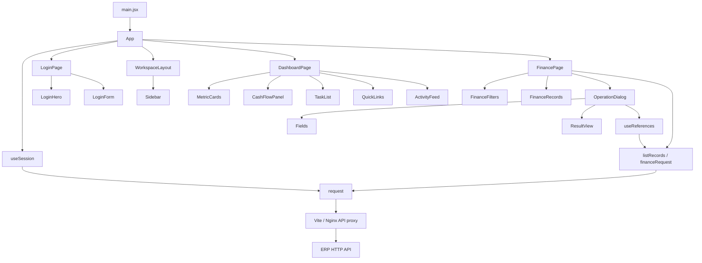
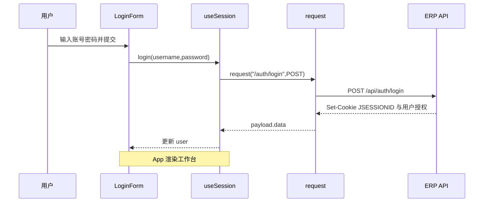

# 衡账前端项目架构与逐页接口说明

本文基于当前源码生成，覆盖登录页、财务总览和 35 个业务页。更新日期为 2026-11-09。逐页操作以 operations.js 的真实定义为准，页面描述中的规划功能与已实现接口存在差别时，以本文操作表和后端校验为准。

## 技术栈与运行边界

| 项目 | 实现 |
| --- | --- |
| 框架 | React 19，函数组件与 Hooks |
| 构建 | Vite 8 与 @vitejs/plugin-react |
| 语言 | JavaScript / JSX，ES Modules |
| 路由 | 自有 Hash 路由，监听 hashchange |
| 请求 | 浏览器 fetch，由 shared/api/client.js 统一封装 |
| 会话 | 服务端 JSESSIONID Cookie，credentials 为 same-origin |
| 状态 | 页面局部 useState，认证状态由 useSession 返回给 App |
| 样式 | 通用基础样式、共享组件样式、页面样式分别维护 |
| 部署 | 本地构建 dist，上传 Linux，Nginx 提供静态文件与 API 代理 |
| 项目边界 | 独立前端项目。运行时访问 HTTP API，前端构建无需 Java、MariaDB 或服务端源码 |

## 源码目录与职责

```text
src/
  main.jsx                         React 挂载及全局样式
  app/
    App.jsx                        会话恢复、页面访问控制、页面装配
    routing/routes.js              从业务模块配置生成路由表
    routing/useHashRoute.js        读取 Hash、监听变化、触发导航回调
    layouts/WorkspaceLayout.jsx    侧栏、顶栏、内容插槽
    layouts/Sidebar.jsx            按资源权限过滤菜单
  pages/
    login/LoginPage.jsx            登录页面布局
    login/views/                   LoginHero、LoginForm
    dashboard/DashboardPage.jsx    工作台请求与视图装配
    dashboard/views/               指标卡、趋势图、待办、快捷入口、动态
    finance/FinancePage.jsx        35 个业务页共用的页面容器
    finance/views/                 筛选、记录、操作弹窗和动态字段编辑
  features/
    auth/useSession.js             查询会话、登录、退出、失效监听
    auth/permissions.js            canAccess
    finance/model/modules/         八个模块的页面与导航描述
    finance/model/definePage.js    page 配置构造函数
    finance/api/resources.js       列表请求、筛选映射、响应字段映射
    finance/api/operations.js      每个操作的路径、方法、表单和标志
    finance/api/fields.js          中文字段名、枚举、多行明细结构
    finance/api/useReferences.js   从业务接口加载关联下拉选项
  shared/
    api/client.js                  请求、统一响应、错误、下载
    api/dates.js                   JDBC DATE 时间戳转业务日期
    ui/                            Icon、Brand 等共享组件与弹窗样式
    styles/                        基础样式与通用视觉样式
scripts/
  generate-architecture.mjs         从页面及接口定义生成本文
  seed-samples.mjs                  通过 API 创建样例数据
  deploy.ps1                       本地编译、打包、SSH/SCP 发布入口
deploy/
  nginx.conf.template              生产静态站点及 API 同源代理
  activate.sh                      服务器端激活、健康检查、失败回滚
docs/
  architecture-intro.md            本文通用架构说明源文件
  architecture-ending.md           本文运行和维护说明源文件
```

35 个业务页复用 FinancePage，由 module 和 page 配置决定页面内容；它们分别在各自的模块配置中定义，并没有 35 个重复的 JSX 页面文件。增加专用交互时，可在对应 pages 目录新增 View，再由页面容器装配。

## 组件和依赖关系



## 应用入口、路由与权限

[main.jsx](src/main.jsx) 导入基础与通用样式，通过 createRoot 挂载 App，开发期启用 StrictMode。

[App.jsx](src/app/App.jsx) 使用 useSession 获取 user、loading、error、login、logout。恢复会话期间显示加载状态，未登录时返回 LoginPage，登录后装配 WorkspaceLayout。业务路由进入 FinancePage，根路由进入 DashboardPage。

[routes.js](src/app/routing/routes.js) 遍历 modules，使用 routeFor(module,page) 生成 module.id/page.id，再由 Map 保存页面配置。getRoute(route) 返回 module 与 page。目前未知 Hash 会回退到财务总览。

[useHashRoute](src/app/routing/useHashRoute.js) 从 window.location.hash 去除 #/ 前缀，监听 hashchange 后更新 route、执行导航回调并滚动到顶部。WorkspaceLayout 的 main 使用 route 作为 key，切换页面时重建页面状态。

[canAccess](src/features/auth/permissions.js) 允许 is_admin 管理员访问全部资源。普通用户按 permissions[].resource 检查读取权限，写入还需 can_write=true 或 1。Sidebar 过滤无权访问的菜单，App 拦截直接打开的无权路由，FinancePage 过滤写操作入口。接口权限继续由后端执行。

## 登录页面

### 组件与状态

| 文件或组件 | 职责 |
| --- | --- |
| [LoginPage](src/pages/login/LoginPage.jsx) | 组合 LoginHero、LoginForm 和页脚，将 onLogin 传给表单 |
| [LoginHero](src/pages/login/views/LoginHero.jsx) | 品牌区、产品文案和业务流程装饰，使用共享 Brand、Icon |
| [LoginForm](src/pages/login/views/LoginForm.jsx) | 账号密码输入、显示密码切换、提交状态、错误显示 |
| [useSession](src/features/auth/useSession.js) | 执行登录请求并把返回的用户资料写入 user 状态 |
| [request](src/shared/api/client.js) | 拼接 /api、发送 Cookie、解析统一响应与错误 |

LoginForm 保存 username、password、showPassword、error 和 busy。submit(event) 先阻止默认表单提交，设置 busy，调用 await onLogin(username,password)。请求失败显示 failure.message，请求结束恢复按钮。密码显示切换只改变 input 的 type。

### 登录、恢复会话和退出的实际调用

| 行为 | 调用链 | HTTP 接口 | 请求或结果 |
| --- | --- | --- | --- |
| 登录 | LoginForm.submit → App 传入的 login → useSession.login → request | POST /api/auth/login | JSON 包含 username.trim() 与原始 password；读取 data 中的用户、角色与授权 |
| 刷新恢复 | App → useSession.useEffect → request | GET /api/auth/session | 读取当前 JSESSIONID 对应的用户，401 时维持未登录 |
| 退出 | WorkspaceLayout 退出按钮 → App.handleLogout → useSession.logout → request | POST /api/auth/logout | JSON 空对象；成功后清空 user，Hash 改为 #/ |
| 会话失效 | request 收到非登录接口的 401 → session-expired 事件 → useSession 监听器 | 任何受保护接口 | 清空 user，使 App 重新显示 LoginPage |



前端没有本地密码比对，不把登录成功标记写入 sessionStorage 或 localStorage。登录后的有效性以服务端会话为准。登录成功保留原来想访问的 Hash，退出成功回到根 Hash。

## 财务总览页面

路由为 #/，权限资源为 dashboard。页面容器是 [DashboardPage](src/pages/dashboard/DashboardPage.jsx)。

| View | 传入数据 | 展示或动作 |
| --- | --- | --- |
| MetricCards | data、currency | balances 汇总资金余额、monthly 汇总收付款、tasks 汇总待办，点击卡片进入相应业务 Hash |
| CashFlowPanel | data.trend、period | 生成连续六个月的柱状图，以万元显示实际收付款，缺失月份按 0 展示 |
| TaskList | data.tasks | 按 resource 展示当前角色待办数量，点击进入业务页 |
| QuickLinks | dashboardData.shortcuts | 展示预设导航链接，不单独请求接口 |
| ActivityFeed | data.activities | 展示操作类型、资源、业务对象和操作时间，链接到相应业务页 |

DashboardPage 保存 period、currency、data 和 error。period 初始为浏览器当前月份，currency 初始为 CNY。useEffect 在 period 或 currency 变化时调用 listRecords('dashboard',{period_code:period,currency},signal)，最终发送 GET /api/finance/dashboard?period_code=...&currency=...。请求返回 period、balances、monthly、trend、tasks、activities。切换条件或卸载时通过 AbortController 取消上一次请求。

## 通用业务页面的请求与渲染流程

### FinancePage 的状态与方法

| 名称 | 职责 |
| --- | --- |
| resource | 由 module.id 和 page.id 组成，例如 gl/vouchers |
| filters | 用户正在编辑的查询条件，以中文条件名为 key |
| query | 已提交给服务器的 snake_case 条件与 page、size |
| data | items、total，以及常规分页或报表元数据 |
| selected | 勾选的后台记录 id，用于批量审核或记账 |
| operation | 当前打开的操作、记录 id、初始值、目标资源 |
| revision | 写操作成功后增加，触发重新查询 |
| search() | filterParams 转换条件，设置 loading，并从第 1 页查询 |
| refresh() | 增加 revision，重新执行列表请求 |
| runAction([title],id) | 查询 operations 定义，处理导出、选中校验、编辑回填、打开弹窗 |
| submit(body) | 替换路径参数、组装 JSON 或 FormData、执行操作、成功刷新 |

### View 组件

| 组件 | 输入 | 内部逻辑 |
| --- | --- | --- |
| FinanceFilters | page、filters、onChange、onReset、onQuery | 内部 FilterField 按名称选择文本、月份、日期或枚举控件；提交时调用 onQuery |
| FinanceRecords | page、actions、rowActions、rowIds、selected、回调 | 按后台 id 渲染勾选、表格和行操作；内部 RowActions 选择动作并回调 onAction |
| OperationDialog | title、operation、initial、onSubmit、onClose | 原生 dialog 管理焦点，保存 values、busy、error、result；成功显示 ResultView |
| Fields | specs、values、references、onChange | 根据字段定义生成输入、多行明细和关联选择器 |
| ResultView | data | 递归展示对象、数组与基础值，通过 fieldLabels 转换已定义的中文名称 |

### 字段与操作定义

operations.js 中 create、row、get、post 是操作定义构造函数，不直接发送请求。resource 用于覆写当前页面资源，suffix 定义路径后缀。row=true 把动作放入行操作，batch=true 要求勾选记录，download=true 直接导出，downloadFile=true 进入附件 Blob 下载，refresh=true 重新查询，unsupported 只显示支持范围。

字段以空格分隔。字段后缀 ? 表示选填，冒号之后表示特殊结构，例如 lines:voucher、steps:workflow、permissions:permissions、segments:numbers。numbers 把逗号分隔内容转成数字数组，多行明细按 lineSchemas 白名单提交字段。can_write 未勾选时显式提交 false。

### HTTP 与数据转换

request(path,options) 为 path 添加 /api 前缀。普通 JSON 操作设置 Content-Type，FormData 交由浏览器生成 multipart boundary。成功响应取 payload.data，HTTP 错误以 ApiError(message,status) 抛出。queryString 省略空字符串、null 和 undefined。

listRecords(resource,params,signal) 拼查询参数，调用 financeRequest。financeRequest 为资源添加 /finance/ 前缀，再调用 request。displayPage 根据字段映射把后端对象转为表格行，同时保存后台 id 供行操作使用。

日期方面，当前服务端的 JDBC DATE 可能返回 UTC 午夜对应的时间戳。normalizeApiData 递归处理 date、*_date、*_on 字段，按 Asia/Shanghai 转回 yyyy-MM-dd。普通操作时间 *_at 不走这个日期转换。

常规列表为 {items,total,page,size}，报表和汇总为 {items,total,...元数据}。只有响应带 page 时，列表下一页才启用。普通列表默认每页 20 条。导出沿用当前筛选，移除分页参数。

文件下载会读取 Blob，解析 Content-Disposition 的 UTF-8 文件名，创建临时 ObjectURL 下载，并在完成后释放。失败仍读取 JSON message。附件上传前端检查 10 MB，服务器负责进一步的文件类型、数量、归属和权限检查。

## 逐页索引

下文每个业务页均列出实际 View 组件、查询字段、展示字段、操作路径和请求参数。前端执行请求的公共方法已在上文解释，每页的“操作”表给出展开后的路径。
